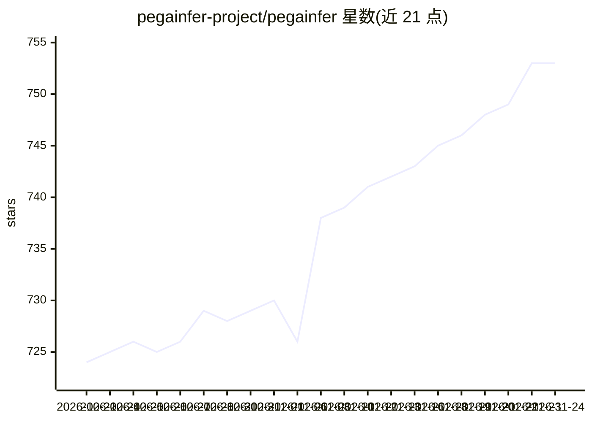

# pegainfer-project/pegainfer

⭐ 753 · Rust · Apache-2.0 · 推送 2026-11-21 · [GitHub](https://github.com/pegainfer-project/pegainfer) · [官网](https://pegainfer.org/) · 组织维护

**Rust+CUDA 的 LLM 推理引擎，OpenAI 兼容 API 服务多模型**

以 Rust 实现的 LLM 推理服务引擎，不依赖 PyTorch 或 Python 运行时，通过 OpenAI 兼容 API（/v1/completions、/v1/chat/completions，支持流式）对外提供推理服务。架构上每个模型拥有独立的调度器、状态与内核，共享 GPU、采样与 KV 基础设施（含 KV offload、PegaFlow 主机/SSD/RDMA 存储）。默认仅启用 Qwen3，其余模型线通过 cargo feature 构建；预编译二进制仅支持 Linux x86_64 + NVIDIA GPU（计算能力 8.x–12.x），也可从源码构建。

## 筛选速览

| 维度 | 判定 | 备注 |
|---|---|---|
| AI 角色 | `ai-ecosystem` | LLM/agent 周边工具 |
| 许可风险 | `permissive` | Apache-2.0 |
| 部署形态 | `library` | 以包/库形式分发 |
| 模型依赖 | — | README 未给出锁定关系 |
| 硬件要求 | — | 无带数字的原话,不猜 |
| 安装摩擦 | `medium` | 含编译或系统依赖之一 |
| 成熟度 | — | 结构信号不足 |

## 能力要点

- OpenAI 兼容 API 服务，支持流式输出
- 纯 Rust + CUDA 实现，无 PyTorch/Python 运行时
- 支持 Qwen3/Qwen3.5、Gemma 4、DeepSeek-V2-Lite、Kimi-K2/K2.5/K3、GLM-5.2 等模型线
- 提供 tensor/expert parallel、prefix cache、KV offload、P/D 分离与投机解码等机制

## 适用场景

- 在自己的 NVIDIA GPU 服务器上以 OpenAI 兼容接口部署 Qwen3 等模型
- 需要脱离 Python/PyTorch 栈的推理服务环境
- 多 GPU 专家并行场景下运行 MoE 模型（如 Kimi-K2 8-GPU EP）

## 场景标签

`推理引擎` · 领域:训练与推理

## 证据(README 行号)

> L1: PegaInfer — LLM inference in Rust and CUDA. Built in Rust. Tuned for production inference.
> L20: PegaInfer serves LLMs through an OpenAI-compatible API. Each model owns its scheduler, state, and kernels; serving 
> L118: Only **`qwen3`** is enabled by default, including in the prebuilt binary. Build other lines with `--features <feat

## 星数曲线

2026-10-22 724 → 2026-11-24 753（+29）

---
*卡片 v1 · prompt 1.4 · 生成 2026-11-24 · 置信度 mid · 依据 README sha `efdebe2cab22` · [字段定义](../../DATASET.md)*
