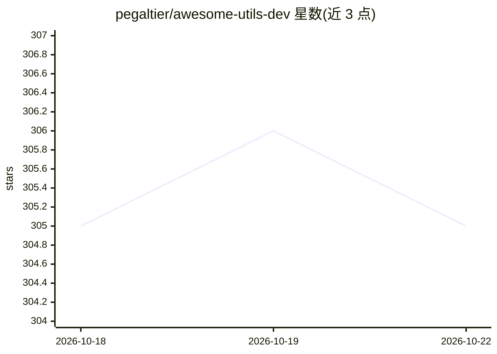

# pegaltier/awesome-utils-dev

⭐ 306 · JavaScript · 推送 2026-10-11 · [GitHub](https://github.com/pegaltier/awesome-utils-dev) · 个人维护

**开发者工具与资源聚合清单（awesome list）**

由个人开发者维护的精选清单仓库：按编程语言、Web 框架、Web 模式、移动开发、后端开发、杂项（含 Ai、Git、Api、GraphQL 等）、基础设施（Kubernetes、容器）与区块链等类目组织，收录工具、资源、链接、笔记与技巧，供开发者在选型和学习时查阅。README 目前仅展示分类骨架，条目内容位于各分类子页面。仓库本身不含代码，无需安装运行，提供 Contributing 指引与作者社交媒体链接。

## 筛选速览

| 维度 | 判定 | 备注 |
|---|---|---|
| AI 角色 | `ai-knowledge` | 知识聚合/清单类 |
| 许可风险 | `none` | — |
| 部署形态 | `None` |  |
| 模型依赖 | — | README 未给出锁定关系 |
| 硬件要求 | — | 无带数字的原话,不猜 |
| 安装摩擦 | `low` | 无编译、无系统依赖或容器化 |
| 成熟度 | — | 结构信号不足 |

## 能力要点

- 覆盖编程语言、Web/移动/后端开发、基础设施、区块链等 8 大类目
- 条目形式为工具、资源、链接、笔记与技巧的聚合
- 开放贡献（Contributing 章节）

## 适用场景

- 按技术类目查找开发工具与资源
- 了解某领域（如 GraphQL、Kubernetes）可用的工具链接
- 向清单提交自己维护的工具或资源

## 场景标签

`精选清单` · 领域:学习与行业

## 证据(README 行号)

> L3:  📔 📚 A curated list of awesome tools, utilities, resources, links, notes, tips, tricks, helpers made by a developer 
> L47: - Ai

## 星数曲线

2026-10-18 305 → 2026-10-22 305（+0）

---
*卡片 v1 · prompt 1.4 · 生成 2026-10-21 · 置信度 high · 依据 README sha `4b963c20b347` · [字段定义](../../DATASET.md)*
