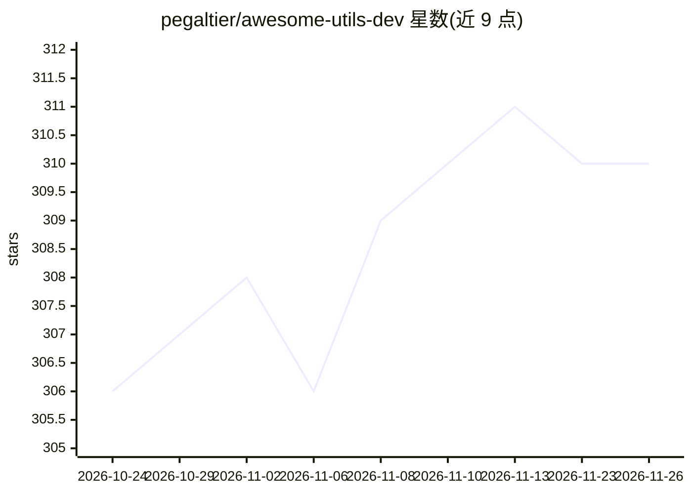

# pegaltier/awesome-utils-dev

⭐ 310 · JavaScript · 推送 2026-11-25 · [GitHub](https://github.com/pegaltier/awesome-utils-dev) · 个人维护

**面向开发者的 IT 工具与资源策展清单**

由个人开发者维护的 awesome 类目录仓库，按编程语言、Web 框架、Web 模式、移动开发、后端开发、基础设施、区块链等多个章节组织工具、资源与链接；其中包含 AI、Git、API、GraphQL 等杂项章节。README 本身仅为目录结构（各章节下为子主题条目），未在可见范围内给出具体工具条目内容、安装说明或许可证信息。

## 筛选速览

| 维度 | 判定 | 备注 |
|---|---|---|
| AI 角色 | `ai-knowledge` | 知识聚合/清单类 |
| 许可风险 | `none` | — |
| 部署形态 | `None` |  |
| 模型依赖 | — | README 未给出锁定关系 |
| 硬件要求 | — | 无带数字的原话,不猜 |
| 安装摩擦 | `low` | 无编译、无系统依赖或容器化 |
| 成熟度 | — | 结构信号不足 |

## 能力要点

- 按编程语言/框架/移动/后端/基础设施/区块链等多章节组织的资源清单
- 涵盖 Angular、React、Vue、NodeJS、Kubernetes、Bitcoin、Ethereum 等主题条目
- 附 Contributing 贡献章节与作者社交链接

## 适用场景

- 查找各类开发工具与学习资源链接
- 按技术方向浏览分类整理的资源目录

## 场景标签

`精选清单` · 领域:学习与行业

## 证据(README 行号)

> L3:  📔 📚 A curated list of awesome tools, utilities, resources, links, notes, tips, tricks, helpers made by a developer 
> L47: - Ai

## 星数曲线

2026-10-24 306 → 2026-11-26 310（+4）

---
*卡片 v1 · prompt 1.4 · 生成 2026-11-25 · 置信度 high · 依据 README sha `4a9a79bdfdb6` · [字段定义](../../DATASET.md)*
