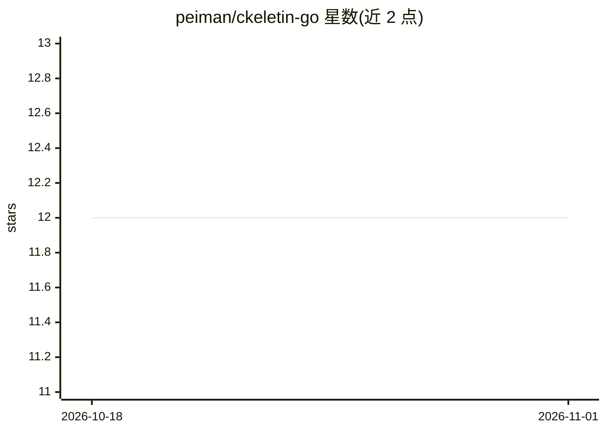

# peiman/ckeletin-go

⭐ 12 · Go · MIT · 推送 2026-10-28 · [GitHub](https://github.com/peiman/ckeletin-go) · 个人维护

**AI-first Go CLI 脚手架框架：让 AI 编码代理产出结构正确的代码**

既是 Go CLI 脚手架也是可更新框架：内置 AGENTS.md/CLAUDE.md、hooks 与自动化检查（task check），把 14 条 ADR 架构规则做成机器可校验，使 Claude Code、Cursor、Copilot 等代理遵循项目架构。框架层 `.ckeletin/` 经 task ckeletin:update 独立升级，含 4 层架构校验、类型安全配置、Zerolog 日志、≥85% 测试覆盖要求与 GPL/AGPL 许可阻断。面向使用 AI 代理的 Go 开发者，通过 git clone + task init 初始化（更新 40+ 文件），也可在 GitHub Codespaces 中运行。

## 筛选速览

| 维度 | 判定 | 备注 |
|---|---|---|
| AI 角色 | `ai-ecosystem` | LLM/agent 周边工具 |
| 许可风险 | `permissive` | MIT |
| 部署形态 | `None` |  |
| 模型依赖 | — | README 未给出锁定关系 |
| 硬件要求 | — | 无带数字的原话,不猜 |
| 安装摩擦 | `low` | 无编译、无系统依赖或容器化 |
| 成熟度 | — | 结构信号不足 |

## 能力要点

- AGENTS.md/CLAUDE.md/hooks/task check 组成的 AI 代理约束栈
- 框架层 .ckeletin/ 独立于项目代码更新
- 14 条 ADR 均有机器可校验的自动化验证
- ≥85% 测试覆盖率与 GPL/AGPL 依赖阻断（ADR-011）

## 适用场景

- 用 AI 编码代理开发 Go CLI 时保持架构一致
- 快速获得生产级 Go CLI 脚手架并持续接收框架改进
- 参考其 AGENTS.md→规则→hooks→强制检查模式改造自有代码库

## 场景标签

`代码生成` · 领域:编码与开发

## 证据(README 行号)

> L21: ckeletin-go is an AI-first Go CLI framework — every architectural rule is machine-checkable, so AI coding agents pr
> L23: - **AI agents build correctly here** — `AGENTS.md`, `CLAUDE.md`, hooks, and automated enforcement mean agents follo
> L53: Most scaffolds produce code that AI agents can write *in* but not write *well in*. Agents guess at conventions, mis

## 星数曲线

2026-10-18 12 → 2026-11-01 12（+0）

---
*卡片 v1 · prompt 1.4 · 生成 2026-11-01 · 置信度 high · 依据 README sha `f3e64b4e17d7` · [字段定义](../../DATASET.md)*
