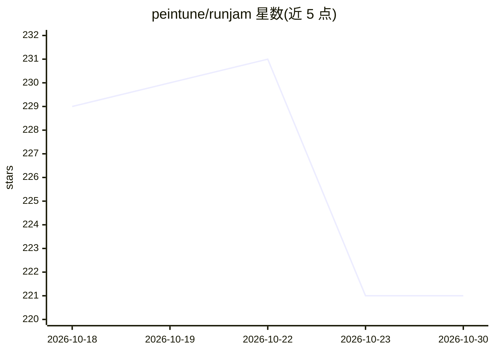

# peintune/runjam

⭐ 221 · Rust · MIT · 推送 2026-10-18 · [GitHub](https://github.com/peintune/runjam) · [官网](https://runjam.app) · 组织维护 · 中文 README

**本地优先桌面端，统一管理多个 AI 编程 Agent CLI**

基于 Tauri 2 + Rust + Vue 3 的桌面应用，用于安装、运行与管理 Claude Code、Codex CLI、Gemini CLI 等 AI 编程 Agent：通过 stdin/stdout 驱动各 Agent 原生 CLI，无需修改 Agent 本身。内置协议代理在 Anthropic/OpenAI/Gemini 间自动转换，使任一 Agent 可接入任一模型（含 llama.cpp + GGUF 本地模型）；提供统一聊天界面、文件树、Monaco 编辑器、xterm.js 终端、会话看板、成本统计与应用管理器。数据存储于 ~/.runjam/，遥测默认开启可在设置中关闭。面向日常使用多个 AI 编程 Agent 的开发者。

## 筛选速览

| 维度 | 判定 | 备注 |
|---|---|---|
| AI 角色 | `ai-ecosystem` | LLM/agent 周边工具 |
| 许可风险 | `permissive` | MIT |
| 部署形态 | `desktop` | 安装包/桌面程序 |
| 模型依赖 | local-ok | 支持本地模型 |
| 硬件要求 | — | 无带数字的原话,不猜 |
| 安装摩擦 | `low` | 无编译、无系统依赖或容器化 |
| 成熟度 | — | 结构信号不足 |

## 能力要点

- 自动检测并一键安装 Claude Code / Codex CLI / Gemini CLI
- 协议代理在 Anthropic ↔ OpenAI ↔ Gemini 间自动转换
- 内置 llama.cpp 服务器管理与 GGUF 模型下载，本地模型零 API 成本
- 会话看板、每会话成本统计与提示缓存命中率展示

## 适用场景

- 在单窗口并行运行多个 AI 编程 Agent 会话
- 让 Claude Code 使用 GPT、Codex 使用 Claude 等跨协议模型组合
- 本地运行 GGUF 开源模型，避免代码与提示离开本机
- 跟踪各会话 token 用量与成本

## 场景标签

`编码 Agent` · 领域:编码与开发

## 证据(README 行号)

> L7: A local-first desktop manager for **Claude Code, Codex CLI, and Gemini CLI** — install once, run any model on any ag
> L37: - **01 · AGENTS** — Any Agent CLI (Claude Code / Codex CLI / Gemini CLI / …) connects via `stdin/stdout` — **no age
> L38: - **02 · RUNJAM CORE** — Three core capabilities: 🔀 **Protocol conversion** (Anthropic ↔ OpenAI ↔ Gemini), 🗂️ **Ses

## 星数曲线

2026-10-18 229 → 2026-10-30 221（-8）

---
*卡片 v1 · prompt 1.4 · 生成 2026-10-22 · 置信度 mid · 依据 README sha `51d04948b1e2` · [字段定义](../../DATASET.md)*
