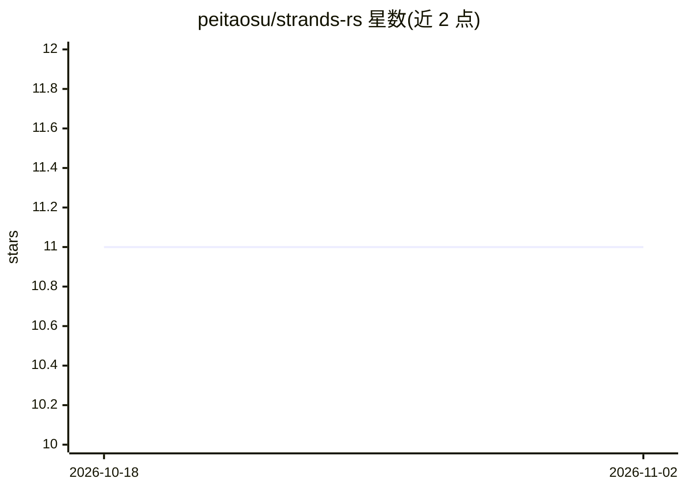

# peitaosu/strands-rs

⭐ 11 · Rust · MIT · 推送 2025-12-23 · [GitHub](https://github.com/peitaosu/strands-rs) · 个人维护

**Rust 实现的 Strands Agents SDK：构建 AI agent 框架**

AWS Strands Agents SDK 的 Rust 移植版，提供以模型驱动编排构建 AI agent 的框架：agent 通过 LLM 推理规划、执行工具并迭代；支持 AWS Bedrock、OpenAI、Anthropic、Ollama 等多提供商；用 #[tool] 宏定义类型安全工具；内置 Graph 与 Swarm 多 agent 模式；基于 Tokio 异步并集成 OpenTelemetry。以 Cargo crate 形式安装，通过 Cargo features 启用 S3 会话持久化等可选功能。MIT 许可。

## 筛选速览

| 维度 | 判定 | 备注 |
|---|---|---|
| AI 角色 | `ai-ecosystem` | LLM/agent 周边工具 |
| 许可风险 | `permissive` | MIT |
| 部署形态 | `library` | 以包/库形式分发 |
| 模型依赖 | local-ok | 支持本地模型 |
| 硬件要求 | — | 无带数字的原话,不猜 |
| 安装摩擦 | `low` | 无编译、无系统依赖或容器化 |
| 成熟度 | — | 结构信号不足 |

## 能力要点

- 模型驱动编排：LLM 推理规划、执行工具并迭代
- 多提供商支持：Bedrock、OpenAI、Anthropic、Ollama 等
- #[tool] 宏定义类型安全工具，支持 MCP
- Graph/Swarm 多 agent 模式与 OpenTelemetry 集成

## 适用场景

- 在 Rust 项目中构建由 LLM 编排的 AI agent
- 组合多个 agent 实现 Graph 或 Swarm 模式的任务编排
- 通过统一接口切换 Bedrock、OpenAI、Ollama 等模型提供商

## 场景标签

`Agent 框架` `多智能体` · 领域:Agent 开发

## 证据(README 行号)

> L3: A Rust implementation of the Strands Agents SDK for building AI agents with model-driven orchestration.
> L11: - **Model-Driven Orchestration** — Agents use LLM reasoning to plan, execute tools, and iterate

## 星数曲线

2026-10-18 11 → 2026-11-02 11（+0）

---
*卡片 v1 · prompt 1.4 · 生成 2026-11-01 · 置信度 high · 依据 README sha `1b37cf27b625` · [字段定义](../../DATASET.md)*
