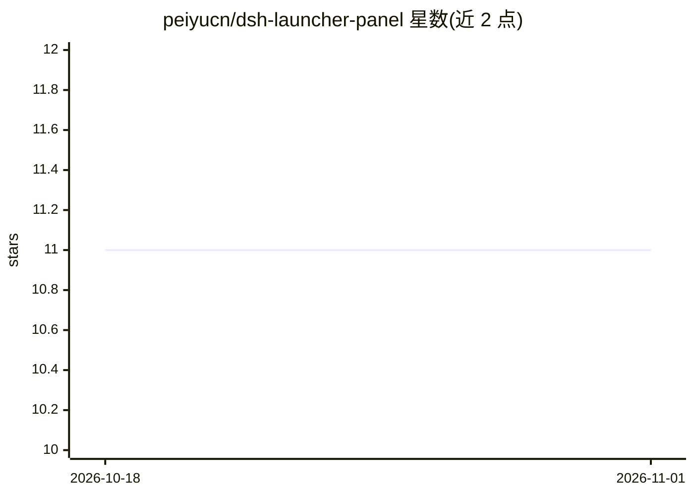

# peiyucn/dsh-launcher-panel

⭐ 11 · TypeScript · MIT · 推送 2026-10-31 · [GitHub](https://github.com/peiyucn/dsh-launcher-panel) · [官网](https://marketplace.visualstudio.com/items?itemName=peiyucn.dsh-launcher-panel) · 个人维护 · 中文 README

**在 VS Code 内启动 DeepSeek Harness 并打开其 Web UI 的扩展**

VS Code 扩展，用于启动/停止 DeepSeek Harness（dsh）并在内置浏览器中打开其 Web UI。不携带模型、dsh 本体或 API key。两种运行模式：pnpm 安装到托管目录，或克隆源码运行。支持多实例（各自独立 DSH_HOME、profile 与端口）、dsh 版本更新、面板显示服务器状态、日志与 DeepSeek API 官方状态（峰谷计价）及账户余额。仅通过公开入口与 ~/.dsh 稳定数据交互，不依赖 dsh 内部实现。已知限制：内置浏览器中语音输入无法解码音频。

## 筛选速览

| 维度 | 判定 | 备注 |
|---|---|---|
| AI 角色 | `ai-ecosystem` | LLM/agent 周边工具 |
| 许可风险 | `permissive` | MIT |
| 部署形态 | `desktop` | 安装包/桌面程序 |
| 模型依赖 | — | README 未给出锁定关系 |
| 硬件要求 | — | 无带数字的原话,不猜 |
| 安装摩擦 | `low` | 无编译、无系统依赖或容器化 |
| 成熟度 | — | 结构信号不足 |

## 能力要点

- pkg（pnpm 托管安装）与 source（源码检出）两种运行模式
- 多实例管理：每实例独立 DSH_HOME/profile/端口，共享一份 dsh 安装
- 面板显示 DeepSeek 官方 API 状态（峰/谷计价）与账户余额
- 仅通过 dsh 公开入口交互，插件在 dsh 升级后仍可用

## 适用场景

- 在 VS Code 里一键启动和停止 DeepSeek Harness 服务
- 并行管理多个 dsh 实例并分别打开各自 Web UI
- 查看 dsh 运行日志与 DeepSeek API 状态/余额

## 场景标签

 · 领域:开发者工具/coding-agent

## 证据(README 行号)

> L7: Start **DeepSeek Harness** (dsh) inside VS Code and open its web UI in the built-in browser.
> L11: > This extension does **not** ship an LLM model, DeepSeek Harness itself, or a DeepSeek API key.

## 星数曲线

2026-10-18 11 → 2026-11-01 11（+0）

---
*卡片 v1 · prompt 1.4 · 生成 2026-11-01 · 置信度 mid · 依据 README sha `bf5268c65981` · [字段定义](../../DATASET.md)*
