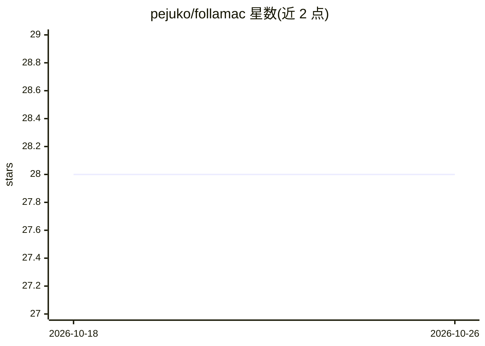

# pejuko/follamac

⭐ 28 · Vue · MIT · 推送 2026-03-26 · [GitHub](https://github.com/pejuko/follamac) · [官网](https://pejuko.github.io/follamac/) · 个人维护

**与 Ollama 及 LLM 交互的桌面客户端**

基于桌面技术栈的 Ollama 前端应用：连接本机运行的 Ollama 服务，提供拉取模型（如 mistral）与对话等操作界面，并带键盘快捷键（ctrl+i 打开开发者工具）。运行前提是 Ollama server 已启动且已拉取模型，模型拉取可通过命令行或应用内完成。本地运行需先 yarn install 再 yarn build/start，另有 yarn dev 开发模式在浏览器中访问。面向使用 Ollama 管理本地 LLM 的用户。

## 筛选速览

| 维度 | 判定 | 备注 |
|---|---|---|
| AI 角色 | `ai-ecosystem` | LLM/agent 周边工具 |
| 许可风险 | `permissive` | MIT |
| 部署形态 | `None` |  |
| 模型依赖 | local-ok | 支持本地模型 |
| 硬件要求 | — | 无带数字的原话,不猜 |
| 安装摩擦 | `low` | 无编译、无系统依赖或容器化 |
| 成熟度 | — | 结构信号不足 |

## 能力要点

- 连接本机 Ollama 服务进行 LLM 操作
- 支持应用内拉取模型（如 mistral）
- 提供开发模式（yarn dev）与开发者工具快捷键

## 适用场景

- 在本机用图形界面管理 Ollama 模型
- 通过桌面客户端与本地 LLM 对话
- 开发调试 Ollama 前端功能

## 场景标签

 · 领域:LLM 客户端/桌面工具

## 证据(README 行号)

> L5: Follamac is a desktop application which provides convenient way to work with Ollama
> L8: The Ollama server must be running. On Linux you can start it using `sudo systemctl start ollama.service`

## 星数曲线

2026-10-18 28 → 2026-10-26 28（+0）

---
*卡片 v1 · prompt 1.4 · 生成 2026-10-26 · 置信度 high · 依据 README sha `8baa6bd509c4` · [字段定义](../../DATASET.md)*
