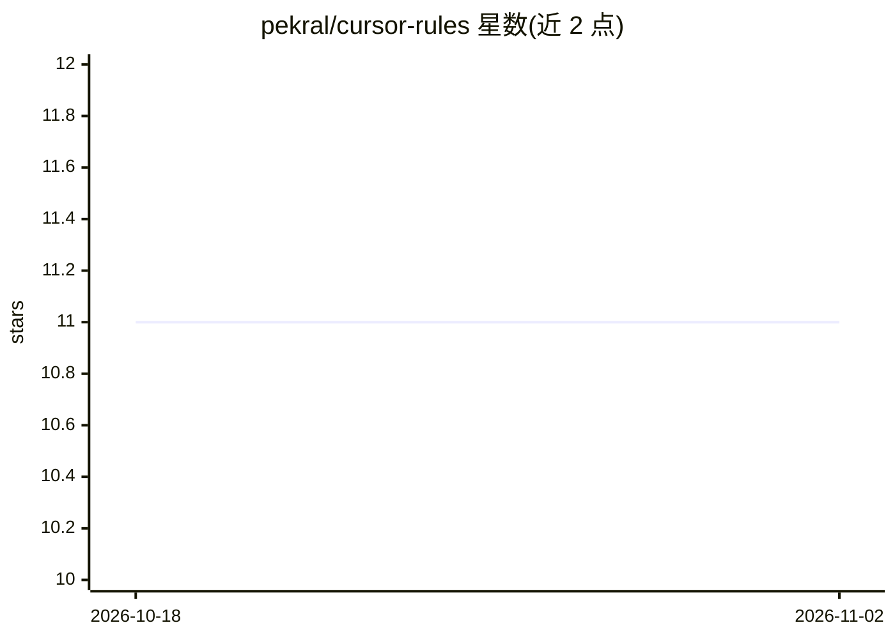

# pekral/cursor-rules

⭐ 11 · PHP · MIT · 推送 2026-10-03 · [GitHub](https://github.com/pekral/cursor-rules) · [官网](https://pekral.cz) · 个人维护

**为 PHP/Laravel 项目安装 Cursor/Claude/Codex 规则与 Agent 技能的 Composer 插件**

面向 PHP/Laravel 开发者的 Composer 插件：通过 `composer require --dev` 安装后，用 CLI 将 `.mdc` 规则文件与 Agent 技能复制或软链接到 Cursor、Claude Code、Codex 三类编辑器/代理的 rules 与 skills 目录（`--editor` 必填，可选 all）。内容覆盖 PHP 8.4 编码规范、Pest 测试约定及 62 个 Agent 技能（issue 解决、代码评审、安全分析、重构、测试等）。默认仅补齐缺失文件不覆盖已有内容，Codex 的规则加载被标注为 experimental/unverified。

## 筛选速览

| 维度 | 判定 | 备注 |
|---|---|---|
| AI 角色 | `ai-ecosystem` | LLM/agent 周边工具 |
| 许可风险 | `permissive` | MIT |
| 部署形态 | `None` |  |
| 模型依赖 | — | README 未给出锁定关系 |
| 硬件要求 | — | 无带数字的原话,不猜 |
| 安装摩擦 | `low` | 无编译、无系统依赖或容器化 |
| 成熟度 | — | 结构信号不足 |

## 能力要点

- 一套包分发规则文件与 62 个 Agent 技能（v0.9.1）
- 支持 Cursor / Claude Code / Codex 三类目标，可一键 all 安装
- 默认不覆盖已有文件，`--force`/`--symlink`/`--prune` 等 CLI 开关
- Cursor 也可免安装直接添加本仓库为 Remote Rule

## 适用场景

- 让 Cursor/Claude Code 在 PHP/Laravel 项目中遵循统一编码与测试规范
- 为 AI 编辑器批量装备 issue 解决、代码评审、安全分析等技能
- 在 composer install/update 时自动同步规则与技能

## 场景标签

`提示工程` · 领域:Agent 开发

## 证据(README 行号)

> L11: **Cursor rules for PHP and Laravel** — a **Composer plugin** for PHP/Laravel projects that installs a complete set 
> L19: - **62 comprehensive Agent skills** for automated workflows (v0.9.1)
> L33: - **codex**: `.codex/rules`, `.codex/skills`, and when `HOME`/`USERPROFILE` is set also `~/.codex/skills`

## 星数曲线

2026-10-18 11 → 2026-11-02 11（+0）

---
*卡片 v1 · prompt 1.4 · 生成 2026-11-01 · 置信度 high · 依据 README sha `83cf5b9d00cb` · [字段定义](../../DATASET.md)*
