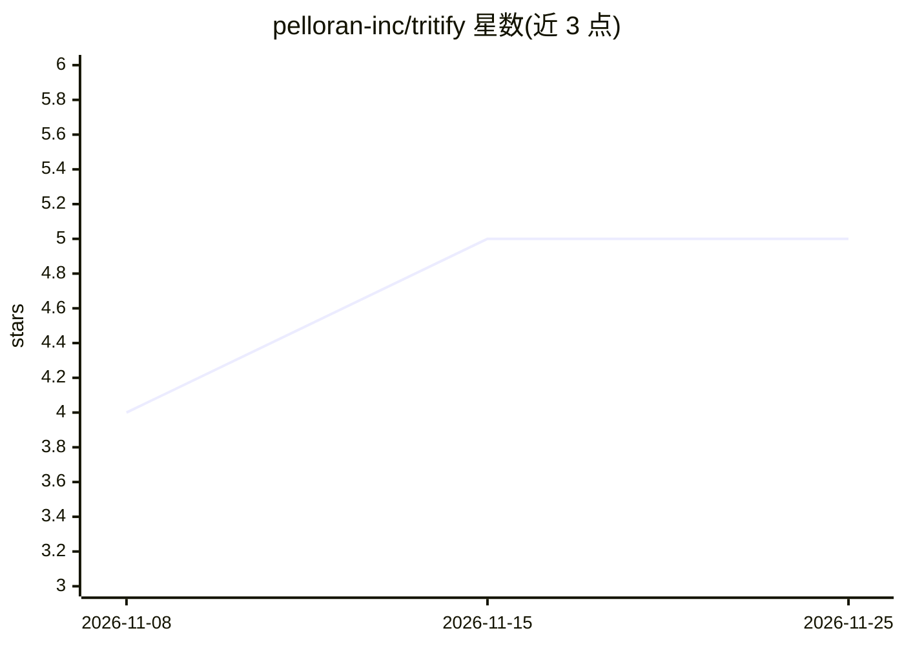

# pelloran-inc/tritify

⭐ 5 · Rust · Apache-2.0 · 推送 2026-11-11 · [GitHub](https://github.com/pelloran-inc/tritify) · 组织维护

**以精确整数运算实现确定性可复现 LLM/SAM 推理的引擎**

用 Rust 编写的推理引擎，在精确整数算术下运行 decoder-only 语言模型、Mixture-of-Experts 解码器与 SAM 2.1 图像/视频栈的前向传播，输出逐字节相同并附带可校验的 SHA-256；每个算子同时提供整数路径与浮点参考，超过声明容差的差异会被门控拒绝。支持跨机器分片运行超出单机内存的模型，并内置 OpenAI 兼容服务器。单一设备上不以吞吐为目标，仅绑定回环地址且默认无认证。

## 筛选速览

| 维度 | 判定 | 备注 |
|---|---|---|
| AI 角色 | `ai-ecosystem` | LLM/agent 周边工具 |
| 许可风险 | `permissive` | Apache-2.0 |
| 部署形态 | `None` |  |
| 模型依赖 | — | README 未给出锁定关系 |
| 硬件要求 | — | 无带数字的原话,不猜 |
| 安装摩擦 | `medium` | 含编译或系统依赖之一 |
| 成熟度 | — | 结构信号不足 |

## 能力要点

- 整数路径输出逐字节相同，SHA-256 可自行校验
- 跨 CPU 指令集与 CPU/GPU 的确定性一致（固定配置下）
- 支持跨机器分片运行 MoE 大模型，专家权重不跨网络传输
- 分层 workspace：kernel、engine、runtime、模型插件、转换工具

## 适用场景

- 在不同硬件上获得逐字节相同的模型推理结果
- 以不可信集群运行大模型并用开放参考复算校验字节
- 精确读取 MoE 路由中哪些专家被触发
- 将 Hugging Face 检查点转换为整数路径并在本地服务

## 场景标签

`推理引擎` `模型量化` · 领域:训练与推理

## 证据(README 行号)

> L18: `tritify` runs the whole forward pass of real models — decoder-only language models,
> L189: |`06-server`|`kt-server`|an OpenAI-compatible inference server|
> L203: - **The defaults:** `kt-server` binds the loopback address, `127.0.0.1:8080`, and has **no authentication**.

## 星数曲线

2026-11-08 4 → 2026-11-25 5（+1）

---
*卡片 v1 · prompt 1.4 · 生成 2026-11-21 · 置信度 high · 依据 README sha `14236a8dbe3d` · [字段定义](../../DATASET.md)*
