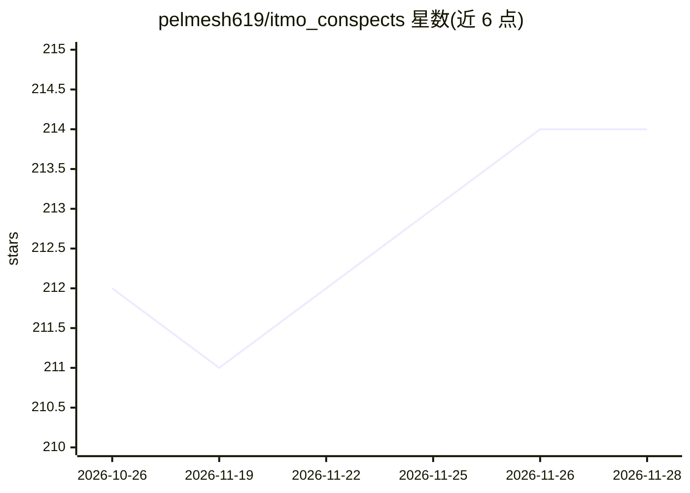

# pelmesh619/itmo_conspects

⭐ 214 · Markdown · Unlicense · 推送 2026-11-27 · [GitHub](https://github.com/pelmesh619/itmo_conspects) · [官网](https://pelmesh619.github.io/itmo_conspects/) · 个人维护

**ITMO 大学软件工程方向的课程笔记合集**

ITMO 大学 2027 届"软件开发"方向学生编写的多课程讲义笔记集合，覆盖 II–VII 学期的数学分析、离散数学、操作系统、数据库、机器学习、Java/Web 开发、DevOps 等课程，部分附考试题纲与 Anki 卡片。笔记以 TeX、Typst、Markdown 三种标记语言编写，提供 Python 脚本（build.py / superconspect.py）将单个文件或整目录编译合并为 PDF。内容以 Unlicense / CC0 双声明发布，另有 GitLab 镜像与网页版。

## 筛选速览

| 维度 | 判定 | 备注 |
|---|---|---|
| AI 角色 | `ai-knowledge` | 知识聚合/清单类 |
| 许可风险 | `permissive` | Unlicense |
| 部署形态 | `library` | 以包/库形式分发 |
| 模型依赖 | — | README 未给出锁定关系 |
| 硬件要求 | — | 无带数字的原话,不猜 |
| 安装摩擦 | `low` | 无编译、无系统依赖或容器化 |
| 成熟度 | — | 结构信号不足 |

## 能力要点

- 覆盖 II–VII 学期多门课程笔记，部分含考试题纲与 Anki 卡片
- TeX/Typst/Markdown 三种格式，Python 脚本编译为 PDF
- 支持合成目录内全部笔记的"超笔记"（superconspect）
- Unlicense / CC0 1.0 双许可，允许商用且无需署名

## 适用场景

- 查阅 ITMO 同类课程的讲义与考试范围
- 用提供的脚本把 TeX/Typst 笔记批量编译成 PDF
- 以 CC0 复用笔记内容编写自己的复习材料

## 场景标签

 · 领域:教育/知识资源

## 证据(README 行号)

> L3: **itmo_conspects** - это сборник конспектов по разным предметам, созданных студентами направления "Разработка ПО" ун
> L324: Конспекты представлены файлами на трех языках разметки: TeX, Typst, Markdown

## 星数曲线

2026-10-26 212 → 2026-11-28 214（+2）

---
*卡片 v1 · prompt 1.4 · 生成 2026-11-25 · 置信度 mid · 依据 README sha `9fbfc958a4fa` · [字段定义](../../DATASET.md)*
