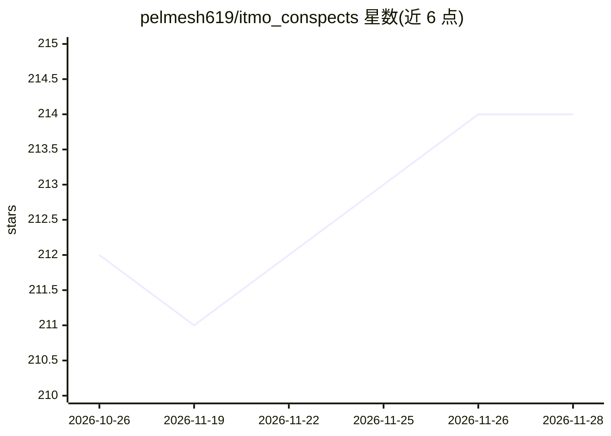

# pelmesh619/itmo_conspects

⭐ 214 · Markdown · Unlicense · 推送 2026-11-27 · [GitHub](https://github.com/pelmesh619/itmo_conspects) · [官网](https://pelmesh619.github.io/itmo_conspects/) · 个人维护

**ITMO 大学学生的各学科课程讲义笔记合集**

ITMO 大学软件工程方向（2027 届）学生整理的课程讲义笔记仓库，覆盖 II–VII 学期的数学分析、离散数学、概率论、数据库、操作系统、机器学习、Java、Web 开发、DevOps、哲学、物理等课程，多数含考试大纲，部分标注 Remastered/Gold。笔记以 TeX、Typst、Markdown 三种格式存放，提供 Python 构建脚本（build.py / superconspect.py）将单篇或整目录笔记编译为 PDF，依赖 Python 3.10+、PyYAML、latexmk 或 typst。

## 筛选速览

| 维度 | 判定 | 备注 |
|---|---|---|
| AI 角色 | `ai-knowledge` | 知识聚合/清单类 |
| 许可风险 | `permissive` | Unlicense |
| 部署形态 | `library` | 以包/库形式分发 |
| 模型依赖 | — | README 未给出锁定关系 |
| 硬件要求 | — | 无带数字的原话,不猜 |
| 安装摩擦 | `low` | 无编译、无系统依赖或容器化 |
| 成熟度 | — | 结构信号不足 |

## 能力要点

- 覆盖 II–VII 学期多门课程的讲义笔记与考试大纲
- 支持 TeX / Typst / Markdown 三种格式
- build.py 与 superconspect.py 编译单篇或合并为超笔记
- 内容采用 Unlicense / CC0 公共领域许可

## 适用场景

- 查阅 ITMO 相关课程的讲义笔记备考
- 复用构建脚本编译自己的 TeX/Typst 笔记
- 以公共领域许可二次分发学习资料

## 场景标签

 · 领域:教育/学习资料

## 证据(README 行号)

> L3: **itmo_conspects** - это сборник конспектов по разным предметам, созданных студентами направления "Разработка ПО" ун
> L329: Конспекты представлены файлами на трех языках разметки: TeX, Typst, Markdown

## 星数曲线

2026-10-26 212 → 2026-11-28 214（+2）

---
*卡片 v1 · prompt 1.4 · 生成 2026-11-28 · 置信度 mid · 依据 README sha `65330268f0ea` · [字段定义](../../DATASET.md)*
