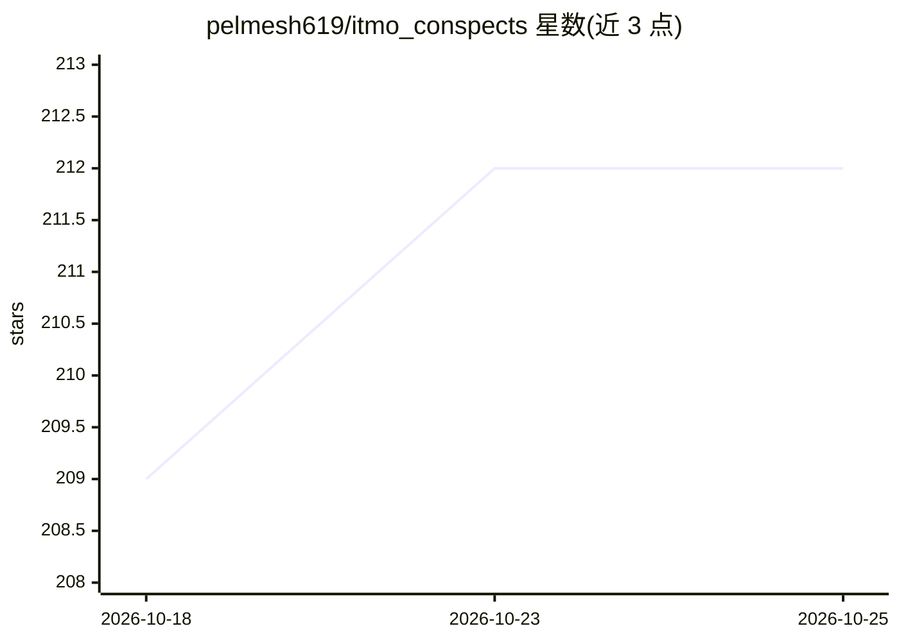

# pelmesh619/itmo_conspects

⭐ 212 · Markdown · Unlicense · 推送 2026-10-23 · [GitHub](https://github.com/pelmesh619/itmo_conspects) · [官网](https://pelmesh619.github.io/itmo_conspects/) · 个人维护

**ИТМО大学学生课程笔记汇编（数学到机器学习等多科目）**

个人维护的大学课程笔记仓库，覆盖ИТМО信息系统专业第II至VII学期的课程：数学分析、离散数学、概率论、数据库、操作系统、Java、机器学习、计算机视觉、DevOps、函数式编程等，部分课程含考试大纲与Anki卡片。笔记以TeX/Typst/Markdown三种标记语言编写，仓库提供Python构建脚本（build.py/superconspect.py/compile_all.py）编译单个文件、合并超级笔记或批量编译，TeX构建依赖latexmk，Typst构建依赖typst工具。许同为Unlicense/CC0双许可。

## 筛选速览

| 维度 | 判定 | 备注 |
|---|---|---|
| AI 角色 | `ai-knowledge` | 知识聚合/清单类 |
| 许可风险 | `permissive` | Unlicense |
| 部署形态 | `None` |  |
| 模型依赖 | — | README 未给出锁定关系 |
| 硬件要求 | — | 无带数字的原话,不猜 |
| 安装摩擦 | `low` | 无编译、无系统依赖或容器化 |
| 成熟度 | — | 结构信号不足 |

## 能力要点

- 覆盖II-VII学期数十门课程的完整或部分笔记
- 提供TeX/Typst/Markdown三格式构建脚本与超级笔记合并功能
- 部分课程附考试大纲、Anki卡片与备忘单
- 镜像于GitLab并提供在线阅读站点

## 适用场景

- ИТМО信息系统专业学生复习各学期课程
- 查阅数据库、操作系统、机器学习等科目的考试材料
- 参考TeX/Typst笔记的组织与构建方式

## 场景标签

`教程课程` · 领域:学习与行业

## 证据(README 行号)

> L3: **Конспекты по разным предметам первого потока ИСy27 университета ИТМО**
> L131: * Машинное обучение (лекторы Власова Е. К., Матвеев С. А.)

## 星数曲线

2026-10-18 209 → 2026-10-25 212（+3）

---
*卡片 v1 · prompt 1.4 · 生成 2026-10-22 · 置信度 high · 依据 README sha `006eb7c1da79` · [字段定义](../../DATASET.md)*
