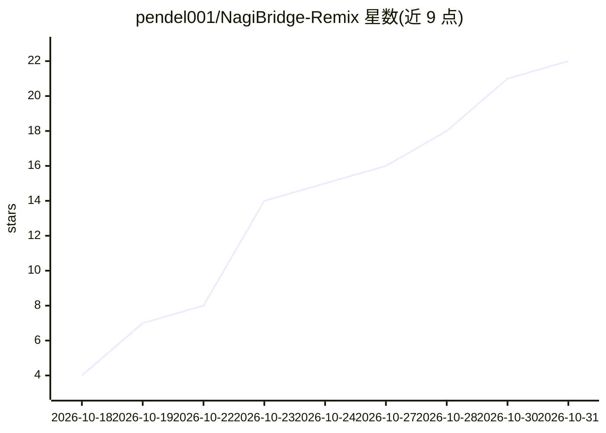

# pendel001/NagiBridge-Remix

⭐ 22 · Python · NOASSERTION · 推送 2026-10-25 · [GitHub](https://github.com/pendel001/NagiBridge-Remix) · 个人维护 · 中文 README

**让外部 AI 通过 MCP 操控星露谷角色的 SMAPI mod + MCP 服务器**

NagiBridge 二改版由两部分组成：装入游戏的 C# SMAPI mod（在 :7842/:7843 起 HTTP 接口、控制角色、游戏原生聊天框对话）与 Python MCP 服务器（:8000，注册 16 个域工具，支持 Claude Code、Cline 等 streamable-http 客户端接入）。AI 以 farmhand 身份进联机房，可走路、种地、下矿、送礼；会话全程落盘为 jsonl 并可导出 markdown 记忆。Releases 提供编译好的 dll（Windows/macOS/Linux 通用），需游戏运行中；源码构建需 .NET SDK 6.0+ 与本地游戏安装。采用 PolyForm Noncommercial 非商用协议。

## 筛选速览

| 维度 | 判定 | 备注 |
|---|---|---|
| AI 角色 | `ai-ecosystem` | LLM/agent 周边工具 |
| 许可风险 | `none` | NOASSERTION |
| 部署形态 | `desktop` | 安装包/桌面程序 |
| 模型依赖 | locked-api |  |
| 硬件要求 | — | 无带数字的原话,不猜 |
| 安装摩擦 | `medium` | 含编译或系统依赖之一 |
| 成熟度 | — | 结构信号不足 |

## 能力要点

- 游戏内 C# mod（HTTP :7842/:7843）+ Python MCP 服务器（:8000，16 个域工具）双组件架构
- AI 以 farmhand 身份在原生聊天框对话并执行浇水/下矿/送礼等操作
- 会话日志全量落盘 jsonl，可导出 markdown 带到其他 AI 前端
- Releases 自带编译 dll，同一 dll 支持 Windows/macOS/Linux

## 适用场景

- 让 Claude Code 等 agent 以农场工身份进我的存档一起玩
- 手机客户端经局域网 MCP 连接操控游戏角色
- 把与 AI 共玩的会话记忆导出并带到新的 AI 前端继续

## 场景标签

 · 领域:游戏/AI agent 工具

## 证据(README 行号)

> L9: NagiBridge 是一个 **星露谷（Stardew Valley）SMAPI mod**，底层是一个控制游戏 + 游戏内 AI 聊天的工具集。它在游戏中放一个可被外部 AI（如 Claude Code）操控的 farmhand
> L24: |**MCP 服务器**（Python）|单独跑的小程序|让外部的 AI（如 Claude Code）操控游戏、并保存会话记录（`:8000`）|
> L89: > **先起 `nagi_mcp_server.py`，再在客户端里填 `http://<IP>:8000/mcp`，传输选 Streamable HTTP。**

## 星数曲线

2026-10-18 4 → 2026-10-31 22（+18）

---
*卡片 v1 · prompt 1.4 · 生成 2026-10-29 · 置信度 mid · 依据 README sha `a2f0285d48af` · [字段定义](../../DATASET.md)*
