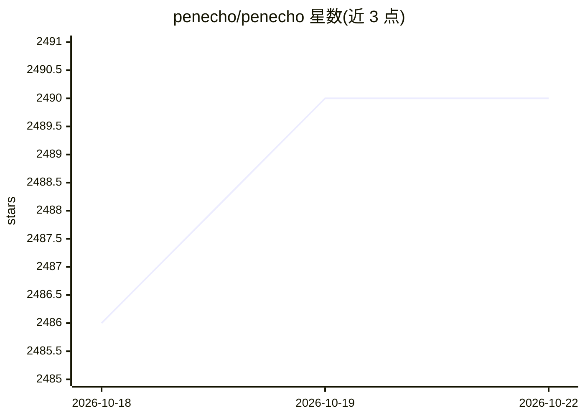

# penecho/penecho

⭐ 2,490 · JavaScript · AGPL-3.0 · 推送 2026-10-21 · [GitHub](https://github.com/penecho/penecho) · [官网](https://penecho.ai) · 组织维护

**给学习/思考者的 AI 画布：手写、公式、图表与交互组件共处一屏**

面向教育与视觉思考场景的共享画布应用：在手写笔记、公式、草图旁由内置 PenEchoLLM 建议下一步操作（求解、排版、绘图、生成图表与可运行的小组件），圈选内容即可转存为可搜索的知识卡片。支持接入自有 OpenAI/Anthropic 兼容 API、已登录的 Codex/Claude Code/Kimi CLI，或通过 MCP 让外部 agent 在画布上作图并读取手写批注。提供 macOS/Windows 桌面版、npm CLI（Node.js 22.19+）与 penecho.ai 云端三种使用方式；本地运行可无需 API key 使用 PenEcho 模型（每日免费试用），云同步与托管模型需账户积分。

## 筛选速览

| 维度 | 判定 | 备注 |
|---|---|---|
| AI 角色 | `ai-native` | 本体是模型或模型工具 |
| 许可风险 | `viral` | AGPL-3.0 |
| 部署形态 | `desktop` | 安装包/桌面程序 |
| 模型依赖 | locked-api |  |
| 硬件要求 | — | 无带数字的原话,不猜 |
| 安装摩擦 | `low` | 无编译、无系统依赖或容器化 |
| 成熟度 | — | 结构信号不足 |

## 能力要点

- PenEchoLLM 暂停后排序建议下一步（Solve/Typeset/Plot 等），答案落在原笔迹处
- Lasso AI 圈选画布局部内容进行求解、可视化或整理
- 画布内容转知识卡片，进入可搜索的 Library
- Local/Cloud MCP 让 Codex、Claude Code 等 agent 在画布上作图并读取手写反馈

## 适用场景

- 手写积分后一键求解并把答案排版在原处
- 让 Claude Code/Codex 把讨论的架构画到画布上，再手写批注反馈
- 把公式、草图整理成知识卡片供复习与检索

## 场景标签

`知识库管理` · 领域:知识与检索

## 证据(README 行号)

> L43:  PenEchoLLM suggests Solve for a handwritten integral; one tap and the answer lands in place
> L45:  Pause after writing and PenEchoLLM ranks what you need next: Solve, Typeset, Plot graph, Make diagram, Organize as
> L162: |**Your model API** — OpenAI- or Anthropic-compatible|Your provider|Full control of model and cost|

## 星数曲线

2026-10-18 2,486 → 2026-10-22 2,490（+4）

---
*卡片 v1 · prompt 1.4 · 生成 2026-10-21 · 置信度 high · 依据 README sha `39375c0d2c9c` · [字段定义](../../DATASET.md)*
