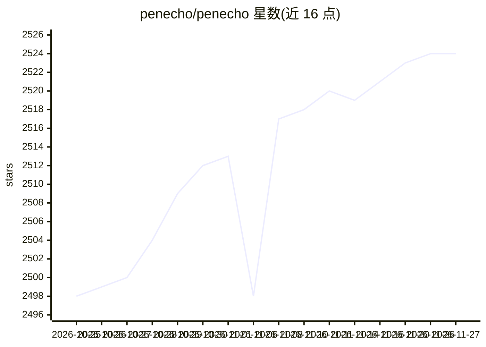

# penecho/penecho

⭐ 2,524 · JavaScript · AGPL-3.0 · 推送 2026-11-26 · [GitHub](https://github.com/penecho/penecho) · [官网](https://penecho.ai) · 组织维护

**多 agent 协作画布：手绘圈注派活、互审与任务编排**

桌面/浏览器端的多 agent 协作工作台：以共享 Canvas 和 Line 组织任务，用户可圈注截图、手绘原型与图表后派给 agent，任务可直发单个 agent 或由 Orchestrator 拆分并按历史记录挑选 agent，一个 agent 构建另一个一键审查、修改回传。任务记录以纯 Markdown（MEMORY.md、lines、works）保存在用户项目文件夹。接入 Claude Code、Codex、Kimi、OpenCode 等既有 agent 会话并同步续接。提供桌面安装包、npm 与浏览器三种使用方式，AGPL-3.0 并另有商业许可。

## 筛选速览

| 维度 | 判定 | 备注 |
|---|---|---|
| AI 角色 | `ai-ecosystem` | LLM/agent 周边工具 |
| 许可风险 | `dual` | AGPL-3.0 |
| 部署形态 | `library` | 以包/库形式分发 |
| 模型依赖 | — | README 未给出锁定关系 |
| 硬件要求 | — | 无带数字的原话,不猜 |
| 安装摩擦 | `low` | 无编译、无系统依赖或容器化 |
| 成熟度 | — | 结构信号不足 |

## 能力要点

- Orchestrator 拆分任务、按 agent 真实记录挑选并逐次评分
- 一键审查与 Send fixes：一个 agent 构建、另一个审查并回传修改
- 圈注截图/手绘/公式/图表，agent 结合标记与文字理解任务
- 同步 Claude Code、Codex、Kimi、OpenCode 等会话并可互相续接

## 适用场景

- 在画布上圈注截图或草图后直接派活给 coding agent
- 让多个 agent 分工完成同一任务并互相审查成果
- 把所有 agent 会话统一到本地 Markdown 记录里管理
- 通过链接与队友共享 Canvas 并在浏览器批注

## 场景标签

`多智能体` `编码 Agent` · 领域:Agent 开发

## 证据(README 行号)

> L68:  How a job reaches your agents: PenEcho sends a direct job to one agent, or an Orchestrator job that is split into 
> L84:  Sessions from Claude Code, Codex, Kimi, OpenCode and more sync in. Continue any of them with any agent.
> L98: Works with Claude Code, Codex, OpenCode, Antigravity, Kimi, Pi, DeepSeek Harness, omp, and PenEcho's built-in runne

## 星数曲线

2026-10-25 2,498 → 2026-11-27 2,524（+26）

---
*卡片 v1 · prompt 1.4 · 生成 2026-11-27 · 置信度 high · 依据 README sha `fffdf5eb94b7` · [字段定义](../../DATASET.md)*
