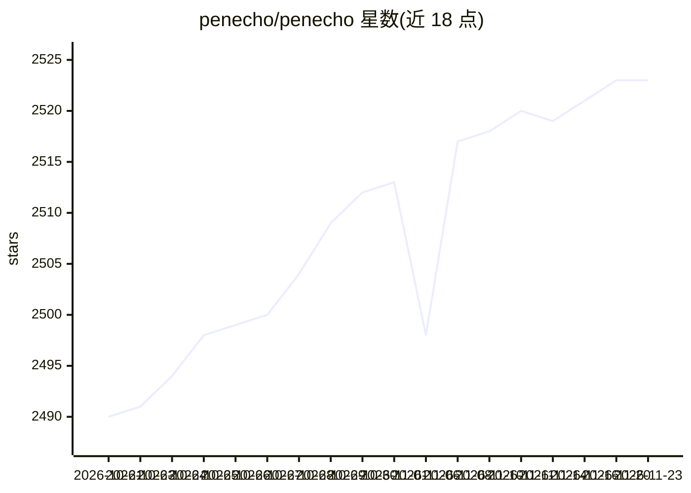

# penecho/penecho

⭐ 2,523 · JavaScript · AGPL-3.0 · 推送 2026-11-02 · [GitHub](https://github.com/penecho/penecho) · [官网](https://penecho.ai) · 组织维护 · 中文 README

**面向学习与思考者的手写画布，AI 以图表和可运行组件呈现答案**

PenEcho 是一个支持手写、公式、文本与图像的无限画布，内置 PenEchoLLM 在用户停笔时建议下一步动作（求解、排版、绘图、整理为笔记），答案直接落在书写位置。圈选手写内容可生成知识卡并收入可检索的 Library。产品同时作为 MCP 服务器运行，Codex、Claude Code、Kimi、Cursor 等客户端的 agent 可在画布上绘制并读取用户批注。提供 macOS/Windows 桌面安装包、npm 全局安装（需 Node.js 22.19+）与 penecho.ai 托管版本；模型可通过账户积分、自有 API key 或已登录的 agent CLI 接入。

## 筛选速览

| 维度 | 判定 | 备注 |
|---|---|---|
| AI 角色 | `ai-native` | 本体是模型或模型工具 |
| 许可风险 | `dual` | AGPL-3.0 |
| 部署形态 | `desktop` | 安装包/桌面程序 |
| 模型依赖 | — | README 未给出锁定关系 |
| 硬件要求 | — | 无带数字的原话,不猜 |
| 安装摩擦 | `low` | 无编译、无系统依赖或容器化 |
| 成熟度 | — | 结构信号不足 |

## 能力要点

- PenEchoLLM 停笔建议：求解/排版/绘图/生成图表等动作一键落地
- 圈选手写内容生成知识卡，自动归类入可检索 Library
- 作为 MCP 服务器接入 Codex/Claude Code/Kimi/Cursor 等 agent 客户端
- 架构图、时序图、流程图自动布局并导出 SVG/PNG

## 适用场景

- 手写数学题或草图后让 AI 直接给出求解与图表
- 让 AI agent 把讨论中的架构或流程画在画布上并接受我的批注修改
- 把课堂笔记和公式整理成可检索复习的知识卡
- 生成带交互组件的计算器、测验或演示原型

## 场景标签

`知识库管理` · 领域:知识与检索

## 证据(README 行号)

> L5:  Bring a question, a sketch, or your notes. PenEcho's built-in AI — or Codex, Claude Code and any MCP client — shows
> L48:  Pause after writing and PenEchoLLM ranks what you need next: Solve, Typeset, Plot graph, Make diagram, Organize as
> L95: Keep talking in the agent you already use. PenEcho gives the work a place to live — your agent draws on the canvas,

## 星数曲线

2026-10-21 2,490 → 2026-11-23 2,523（+33）

---
*卡片 v1 · prompt 1.4 · 生成 2026-11-23 · 置信度 high · 依据 README sha `a459a0f9cd57` · [字段定义](../../DATASET.md)*
