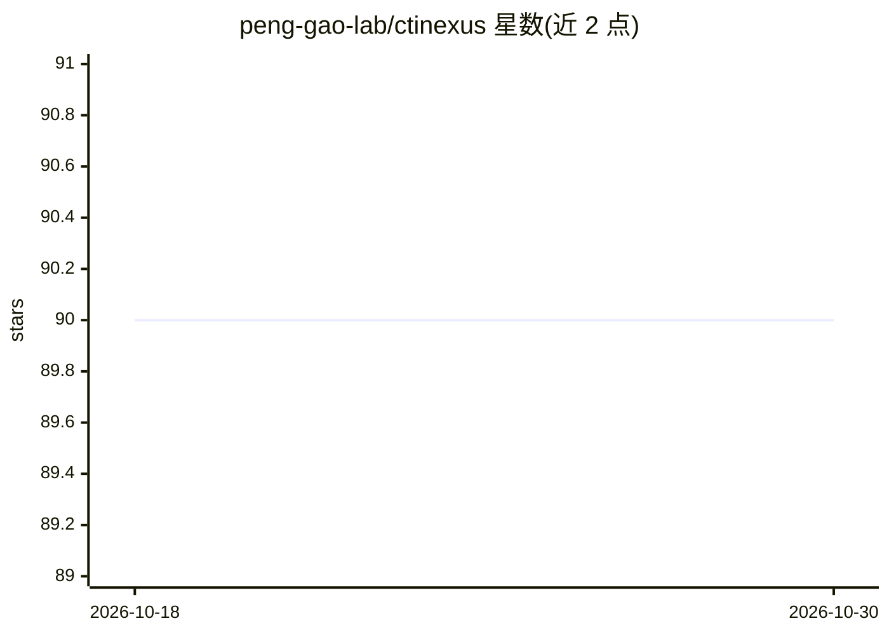

# peng-gao-lab/ctinexus

⭐ 90 · Python · MIT · 推送 2026-02-25 · [GitHub](https://github.com/peng-gao-lab/ctinexus) · [官网](https://CTINexus.github.io) · 组织维护

**用 LLM 上下文学习从威胁情报文本自动构建网络安全知识图谱的框架**

面向网络安全研究者与工程师的框架：通过优化的 LLM 上下文学习（ICL），从非结构化威胁情报报告或 URL 中抽取安全实体与关系，经分层实体对齐（类型分类、实体合并、IOC 保护）和链接预测后构建网络安全知识图谱，并支持交互式可视化。使用需配置至少一个 AI 提供商（OpenAI/Gemini/AWS Bedrock/Ollama），Ollama 为本地免费选项。提供 pip 包、Gradio Web 界面、Docker 与 CLI 四种使用方式，论文发表于 Euro S&P 2025。

## 筛选速览

| 维度 | 判定 | 备注 |
|---|---|---|
| AI 角色 | `ai-native` | 本体是模型或模型工具 |
| 许可风险 | `permissive` | MIT |
| 部署形态 | `self-host` | docker 或自建部署 |
| 模型依赖 | local-ok | 支持本地模型 |
| 硬件要求 | — | 无带数字的原话,不猜 |
| 安装摩擦 | `low` | 无编译、无系统依赖或容器化 |
| 成熟度 | — | 结构信号不足 |

## 能力要点

- 从非结构化 CTI 文本抽取实体与关系并构建知识图谱
- 分层实体对齐（实体类型分类 + 实体合并，含 IOC 保护）
- 链接预测补全知识图谱缺失关系
- 提供 Python 包、Gradio Web 界面、Docker 与 CLI 四种使用方式

## 适用场景

- 从威胁情报报告或博客 URL 提取 IOCs 并构建知识图谱
- 批量处理 CTI 文档做自动化实体关系抽取
- 可视化分析威胁情报中的安全概念关联

## 场景标签

`知识图谱` `网络安全` · 领域:知识与检索

## 证据(README 行号)

> L26: **CTINexus** is a framework that leverages optimized in-context learning (ICL) of large language models (LLMs) to a
> L32: - 🔍 **Extract cybersecurity entities** (malware, vulnerabilities, tactics, IOCs)

## 星数曲线

2026-10-18 90 → 2026-10-30 90（+0）

---
*卡片 v1 · prompt 1.4 · 生成 2026-10-23 · 置信度 high · 依据 README sha `29fea6d2cb33` · [字段定义](../../DATASET.md)*
