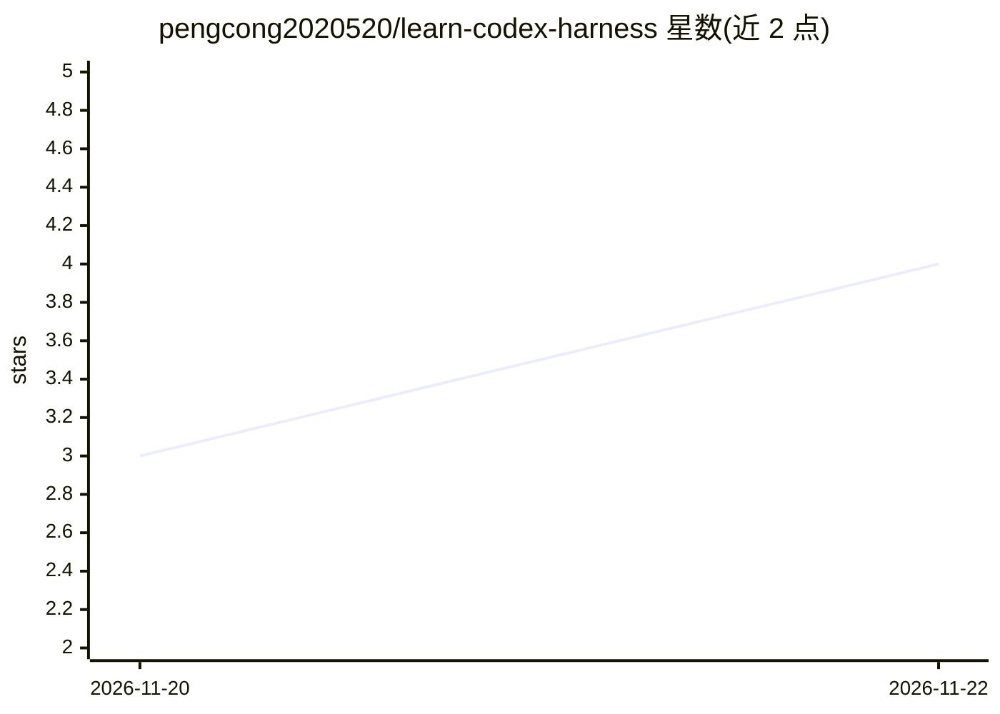

# pengcong2020520/learn-codex-harness

⭐ 4 · JavaScript · MIT · 推送 2026-11-15 · [GitHub](https://github.com/pengcong2020520/learn-codex-harness) · 个人维护 · 中文 README

**开发者用 Codex harness 逐步搭建云端 Agent 的 19 章教程与脚手架**

仓库包含 s00–s18 十九章教程与以 s18 为内核的通用云端 Agent 脚手架两部分。教程按六阶段递进：单轮问答、多轮会话、服务化、事件与消息、Agent 装配（工具白名单、MCP 回调、记忆开关）、数据层、知识层、模型网关、上云部署、账号认证、用户隔离、etcd 协调面、分片路由与副本故障接管，每阶段是独立可运行并带离线测试的代码快照。执行内核不自造 agent loop，依赖 openai/codex 的 App Server 协议。脚手架提供多用户网页聊天、CLI、模型网关与可选集群。运行需 Node.js ≥24 与 Docker，s08 起需 PostgreSQL 与 Redis。

## 筛选速览

| 维度 | 判定 | 备注 |
|---|---|---|
| AI 角色 | `ai-knowledge` | 知识聚合/清单类 |
| 许可风险 | `permissive` | MIT |
| 部署形态 | `library` | 以包/库形式分发 |
| 模型依赖 | — | README 未给出锁定关系 |
| 硬件要求 | — | 无带数字的原话,不猜 |
| 安装摩擦 | `low` | 无编译、无系统依赖或容器化 |
| 成熟度 | — | 结构信号不足 |

## 能力要点

- s00–s18 十九章教程，每章为独立可运行、可测试的代码快照
- 基于 openai/codex 的 harness 与 App Server 协议，不自造 agent loop
- 脚手架含多用户网页聊天、CLI、模型网关与可选集群
- 提供互动机制课程（s01–s18 共 52 节）与阶段演示页面

## 适用场景

- 逐章学习如何用 Codex harness 搭建常驻云端 Agent 服务
- 直接使用脚手架搭建多用户网页聊天与模型网关
- 理解多机副本、分片路由与故障接管的实现方式

## 场景标签

`教程课程` `模型网关` `聊天机器人` · 领域:Agent 开发

## 证据(README 行号)

> L3: 这个仓库包含两部分：**s00–s18 共十九章教程**，以及以 s18 为内核、默认单节点的 **通用云端 Agent 脚手架**。
> L25: 这套教程带你一步步搭出一个**通用的云端 Agent 脚手架**：常驻在服务器上、随时可以连上去用，换一份 Agent 配置就是你自己的 Agent（教程用一个写作助手作为示例）。**每个阶段只多一个单元**，每一步都是可以独立运
> L91: > **s00 先体验** &nbsp; *"模型提出操作，harness 负责执行"* — 用官方 SDK 交给 Codex 一个真实任务，看 harness 替你做了什么

## 星数曲线

2026-11-20 3 → 2026-11-22 4（+1）

---
*卡片 v1 · prompt 1.4 · 生成 2026-11-21 · 置信度 high · 依据 README sha `c00e911ac8da` · [字段定义](../../DATASET.md)*
