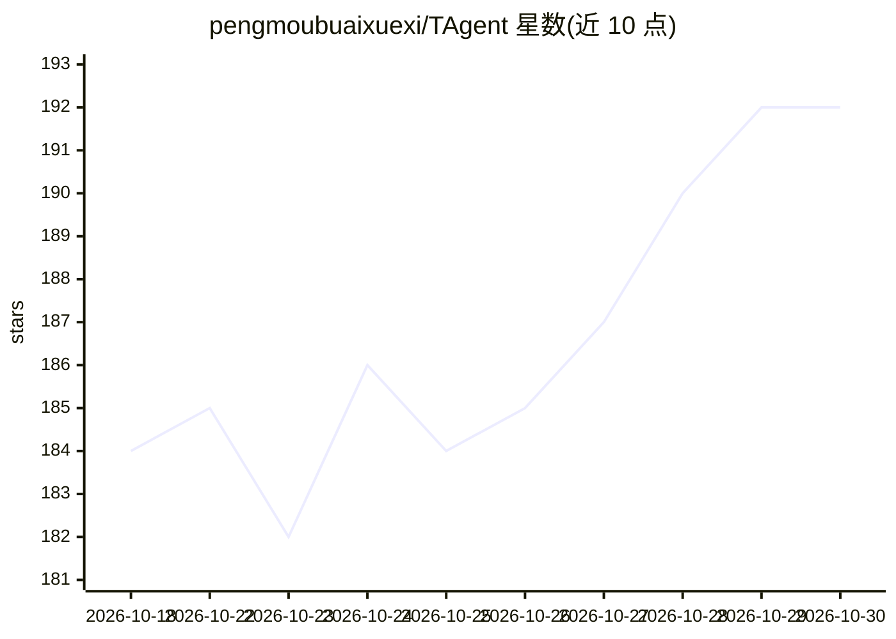

# pengmoubuaixuexi/TAgent

⭐ 192 · Java · MIT · 推送 2026-10-29 · [GitHub](https://github.com/pengmoubuaixuexi/TAgent) · 个人维护 · 中文 README

**Java/Spring AI 的企业级 Agent 工程实践框架**

基于 Java 17、Spring Boot 3.4.3、Spring AI 1.1.7 与 DDD 分层构建的 AI Agent 工程实践项目，覆盖 Agent 请求从接入、统一路由、运行时懒装配，到 Fixed/Auto/Flow 三种执行模式、Agentic RAG（SIMPLE/HYDE/FUSION/DECOMPOSE 四种检索策略）、四层记忆、MCP 工具治理与自愈、人工审批、执行中干预、SSE 流式输出与 Prometheus/ELK/Jaeger 全链路观测的完整过程。面向学习 Java/Spring AI Agent 工程化落地的开发者、研究 MCP 工具治理与 Agentic RAG 的同学，以及需要参考流式 SSE 与人机协同完整链路的团队。技术栈含 MySQL、pgvector、Redis、Elasticsearch。README 未给出安装运行命令。

## 筛选速览

| 维度 | 判定 | 备注 |
|---|---|---|
| AI 角色 | `ai-ecosystem` | LLM/agent 周边工具 |
| 许可风险 | `permissive` | MIT |
| 部署形态 | `None` |  |
| 模型依赖 | — | README 未给出锁定关系 |
| 硬件要求 | — | 无带数字的原话,不猜 |
| 安装摩擦 | `medium` | 含编译或系统依赖之一 |
| 成熟度 | `idea` | |

## 能力要点

- Fixed/Auto/Flow 三种 Agent 执行模式，Flow 支持 DAG 编排与计划确认
- 动态 MCP 工具补充：路由预推断与 request_tool 元工具，PgVector 语义匹配
- Agentic RAG 四种查询策略与四层记忆（工作/对话/长期/情景）
- MCP 自愈（懒探活、重试、重连冷却、熔断）与人工审批、执行中干预

## 适用场景

- 系统学习 Java/Spring AI 的 Agent 工程化落地
- 参考 MCP 工具治理、动态工具补挂与多层记忆的实现
- 研究流式 SSE、人工审批、执行中干预与可观测性的完整链路

## 场景标签

`Agent 框架` `RAG` `教程课程` · 领域:Agent 开发

## 证据(README 行号)

> L14: > 不只是简单的模型封装，而是覆盖 Agent 请求的完整生命周期：接入、路由、运行时装配、规划执行、RAG、记忆、MCP 工具治理、人工审批、交互通知、执行中干预，到 SSE 流式输出和全链路观测。
> L18: TAgent 是一个基于 **Java 17**、**Spring Boot**、**Spring AI** 和 **DDD 分层架构** 构建的企业级 AI Agent 工程实践项目。
> L41: ### 适合谁

## 星数曲线

2026-10-18 184 → 2026-10-30 192（+8）

---
*卡片 v1 · prompt 1.4 · 生成 2026-10-22 · 置信度 high · 依据 README sha `4b71be896ee5` · [字段定义](../../DATASET.md)*
