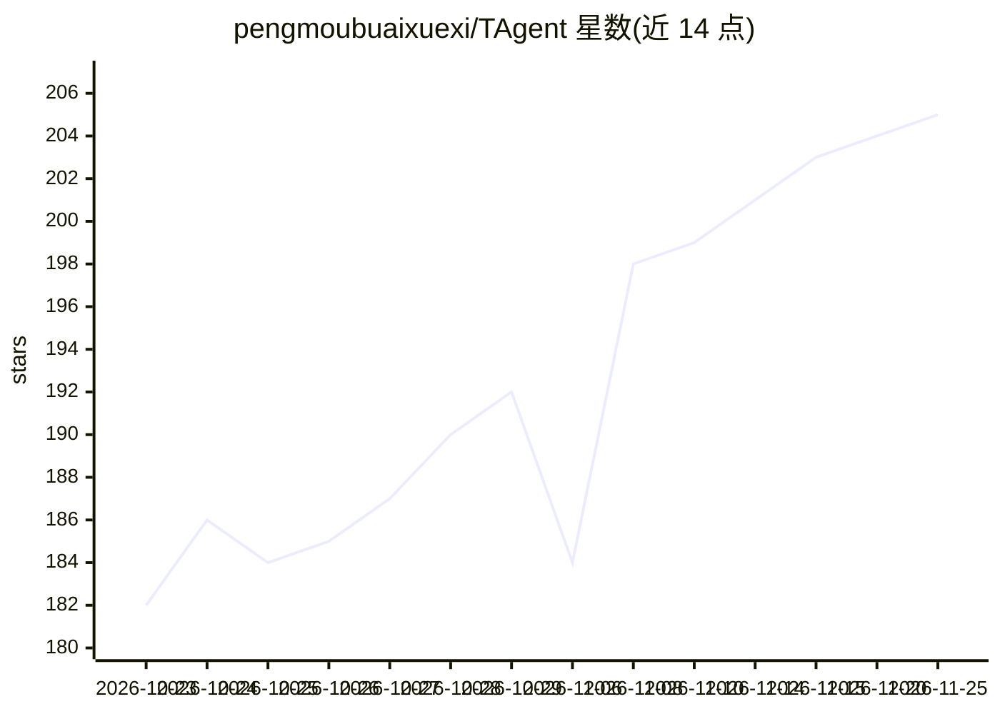

# pengmoubuaixuexi/TAgent

⭐ 205 · Java · MIT · 推送 2026-10-30 · [GitHub](https://github.com/pengmoubuaixuexi/TAgent) · [官网](https://tagentapp.cn/) · 个人维护 · 中文 README

**给 Java 开发者的 Agent 工程化参考项目**

基于 Java 17、Spring Boot 3.4.3 与 Spring AI 的 AI Agent 工程实践项目，采用 DDD 分层。覆盖请求接入、统一路由、运行时懒装配、Fixed/Auto/Flow 三种执行模式、Agentic RAG 四种查询策略、四层记忆、MCP 工具治理与自愈、人工审批、执行中干预（steer/answer_now/cancel）、SSE 流式输出及 Prometheus/ELK/Jaeger 观测。v2 提供个人 Agent 工作台、OpenAI 兼容模型连接、Python 沙箱与评测流程。平台模型受试用额度限制，产物暂不支持 Word/PDF/Excel/ZIP。

## 筛选速览

| 维度 | 判定 | 备注 |
|---|---|---|
| AI 角色 | `ai-ecosystem` | LLM/agent 周边工具 |
| 许可风险 | `permissive` | MIT |
| 部署形态 | `None` |  |
| 模型依赖 | — | README 未给出锁定关系 |
| 硬件要求 | — | 无带数字的原话,不猜 |
| 安装摩擦 | `medium` | 含编译或系统依赖之一 |
| 成熟度 | — | 结构信号不足 |

## 能力要点

- 三种 Agent 执行模式：Fixed 顺序链、Auto 分析闭环、Flow DAG 编排
- 动态 MCP 工具补充：路由预推断与 request_tool 元工具结合 PgVector 语义匹配
- Agentic RAG 四策略（SIMPLE/HYDE/FUSION/DECOMPOSE）与四层记忆
- 运行快照支持步骤级定点重做与断线续作重连

## 适用场景

- 学习 Java/Spring AI Agent 工程化落地的完整链路
- 参考 MCP 工具治理、动态补挂与多层记忆的实现方案
- 参考流式 SSE、人工审批与可观测性的生产实践

## 场景标签

`RAG` `Agent 框架` · 领域:Agent 开发

## 证据(README 行号)

> L3: 🚀 **面向生产实践的 AI Agent 工程框架**
> L14: > 不只是简单的模型封装，而是覆盖 Agent 请求的完整生命周期：接入、路由、运行时装配、规划执行、RAG、记忆、MCP 工具治理、人工审批、交互通知、执行中干预，到 SSE 流式输出和全链路观测。
> L43: - 想系统学习 **Java / Spring AI Agent 工程化落地**的开发者。

## 星数曲线

2026-10-23 182 → 2026-11-25 205（+23）

---
*卡片 v1 · prompt 1.4 · 生成 2026-11-25 · 置信度 high · 依据 README sha `abbab3569638` · [字段定义](../../DATASET.md)*
