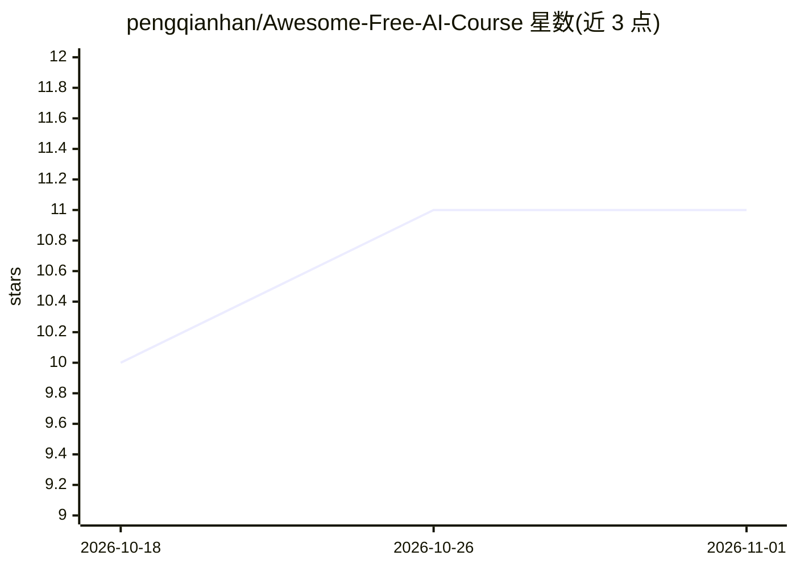

# pengqianhan/Awesome-Free-AI-Course

⭐ 11 · Jupyter Notebook · 推送 2026-10-27 · [GitHub](https://github.com/pengqianhan/Awesome-Free-AI-Course) · 个人维护 · 中文 README

**免费 AI/深度学习学习资料清单，附个人学习笔记与代码**

两部分组成的 AI 学习知识库：一是按 Python、机器学习、深度学习、强化学习、图神经网络、LLM、Diffusion 等方向整理的免费学习资源链接合集，含 Transformer 专题与论文写作资料，通过 Issue/PR 接受社区补充；二是维护者在学习与科研过程中写下的笔记与带注释代码，覆盖 nanoGPT、minimind（含多模态版）、VAE/VQ-VAE、生存分析、混合自动机等主题，.ipynb 文件可在 GitHub 预览或用 Jupyter/VS Code 运行。面向想系统入门 AI 或查找特定主题资料的读者。

## 筛选速览

| 维度 | 判定 | 备注 |
|---|---|---|
| AI 角色 | `ai-knowledge` | 知识聚合/清单类 |
| 许可风险 | `none` | — |
| 部署形态 | `None` |  |
| 模型依赖 | — | README 未给出锁定关系 |
| 硬件要求 | — | 无带数字的原话,不猜 |
| 安装摩擦 | `low` | 无编译、无系统依赖或容器化 |
| 成熟度 | — | 结构信号不足 |

## 能力要点

- 多方向免费学习资源汇总（ML/DL/RL/GNN/LLM/Diffusion 等）
- Transformer 专题资料含中文版与英文版
- nanoGPT / minimind / VAE / VQ-VAE 等带注释学习笔记与代码
- 通过 Issue / Pull Request 接受资料推荐与纠错

## 适用场景

- 零基础系统入门 AI，找成体系课程与书籍
- 专门学习 Transformer 或从零训练 LLM 的配套笔记
- 查找论文写作与数学基础等辅助资料

## 场景标签

`精选清单` `教程课程` · 领域:学习与行业

## 证据(README 行号)

> L20: 1. **学习资料合集**：网上收集的经典、免费的 AI 学习资源，覆盖 Python、机器学习、深度学习、强化学习、图神经网络、LLM、Diffusion 等方向，不定期更新。
> L21: 2. **学习笔记与代码**：我在学习和科研过程中写的笔记、公式推导和带注释的代码，包括 nanoGPT、minimind、VAE / VQ-VAE、生存分析、混合自动机等主题。

## 星数曲线

2026-10-18 10 → 2026-11-01 11（+1）

---
*卡片 v1 · prompt 1.4 · 生成 2026-11-01 · 置信度 high · 依据 README sha `1e16364d1b7a` · [字段定义](../../DATASET.md)*
