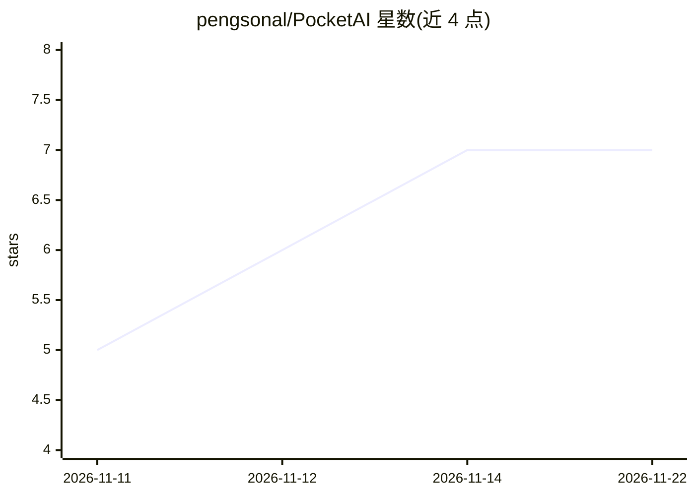

# pengsonal/PocketAI

⭐ 7 · 推送 2026-11-10 · [GitHub](https://github.com/pengsonal/PocketAI) · 个人维护

**在手机上完全离线运行 GGUF 语言模型的开源 App 使用指南**

本仓库是一份面向 PocketPal AI 应用（MIT 许可，iOS/Android）的使用指南，而非应用本体：覆盖官方安装入口（App Store/Google Play/APK）、系统与内存要求、应用内模型下载与加载流程、本地 GGUF 文件导入方法，并推荐五个公开的 uncensored/abliterated 小型 GGUF 模型及按手机内存的选型建议。模型下载后可在飞行模式下本地对话；网页搜索、PalsHub 等为可选联网功能。仓库本身不托管任何模型文件。

## 筛选速览

| 维度 | 判定 | 备注 |
|---|---|---|
| AI 角色 | `ai-native` | 本体是模型或模型工具 |
| 许可风险 | `permissive` | — |
| 部署形态 | `desktop` | 安装包/桌面程序 |
| 模型依赖 | — | README 未给出锁定关系 |
| 硬件要求 | — | 无带数字的原话,不猜 |
| 安装摩擦 | `low` | 无编译、无系统依赖或容器化 |
| 成熟度 | — | 结构信号不足 |

## 能力要点

- 提供 iOS/Android 三种官方安装途径（App Store、Google Play、GitHub APK）
- 按手机 RAM 给出 Q4_K_M 模型文件大小选型对照表
- 支持从 Hugging Face 搜索下载或从本地存储导入 GGUF 模型
- 应用含设备端语音输入、文字转语音与 Metal GPU 加速（需 iOS 18+）

## 适用场景

- 在无网络环境下用手机本地对话运行小模型
- 按手机内存挑选合适的量化 GGUF 模型
- 无法访问应用商店时通过 APK 侧载安装

## 场景标签

`聊天机器人` `教程课程` · 领域:对话与助手

## 证据(README 行号)

> L24: PocketPal AI is a free, open source app (MIT license) that runs language models on your phone. Officially, it is "a
> L30: The app can also do on-device voice input, text-to-speech, and optional tools. This guide focuses on text chat with
> L66: Only the install and download steps need internet. After the model is on the phone, chat can run fully offline.

## 星数曲线

2026-11-11 5 → 2026-11-22 7（+2）

---
*卡片 v1 · prompt 1.4 · 生成 2026-11-20 · 置信度 high · 依据 README sha `7225298da277` · [字段定义](../../DATASET.md)*
