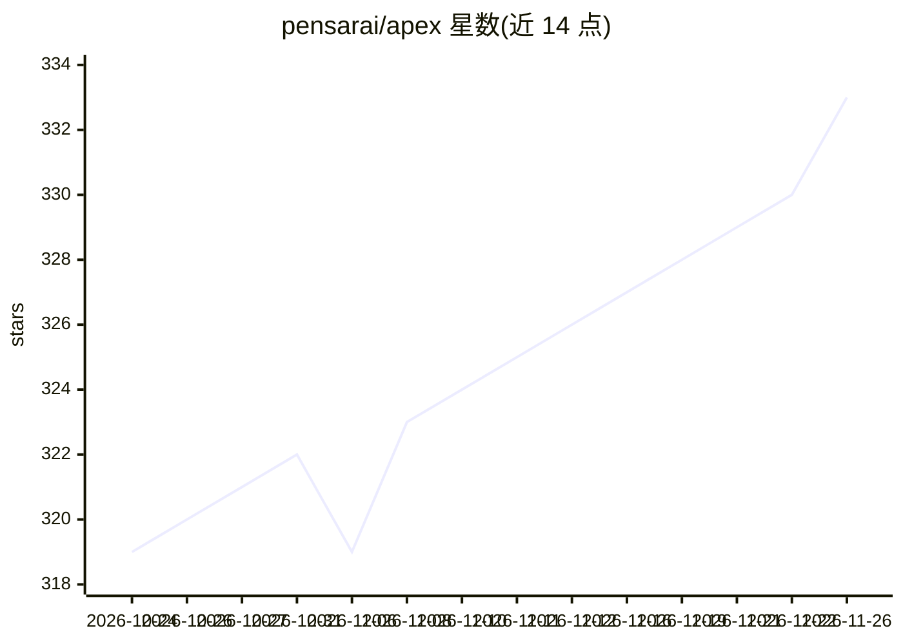

# pensarai/apex

⭐ 333 · TypeScript · Apache-2.0 · 推送 2026-11-25 · [GitHub](https://github.com/pensarai/apex) · [官网](https://pensar.dev) · 组织维护

**终端里的自主 agent 渗透测试工具，供开发者与安全工程师使用**

基于自主 agent 的渗透测试 CLI/TUI 工具，支持黑盒与白盒模式：对目标 URL 执行探索与漏洞挖掘，输出带严重性评分、证据与修复建议的发现。提供 /pentest 自动化测试与 /operator 手动调查模式，支持持久化记忆、headless CLI 以接入 CI/CD，可通过 Ollama 使用本地模型或接入多种推理服务商，并可选在预置渗透工具的 Kali Linux 容器中运行。适用于无需安全背景的开发者与安全工程师团队。

## 筛选速览

| 维度 | 判定 | 备注 |
|---|---|---|
| AI 角色 | `ai-native` | 本体是模型或模型工具 |
| 许可风险 | `permissive` | Apache-2.0 |
| 部署形态 | `self-host` | docker 或自建部署 |
| 模型依赖 | local-ok | 支持本地模型 |
| 硬件要求 | — | 无带数字的原话,不猜 |
| 安装摩擦 | `low` | 无编译、无系统依赖或容器化 |
| 成熟度 | — | 结构信号不足 |

## 能力要点

- /pentest 与 /operator 双模式，覆盖自动测试与手动利用链验证
- headless CLI 支持 --target/--cwd/--model 等参数以接入脚本与 CI
- 自动发现并支持 Ollama 本地模型，无需 API key 或手动端点配置
- 通过 OpenTelemetry/W&B Weave 输出 agent 追踪与结构化日志

## 适用场景

- 合并 PR 前对目标服务做自动化渗透测试
- 安全团队跨大规模攻击面部署 agent 编组测试
- 在 CI/CD 流水线中以 headless 方式运行安全检测

## 场景标签

`网络安全` · 领域:学习与行业

## 证据(README 行号)

> L3: AI-powered penetration testing using autonomous agents — directly in your terminal. Run blackbox and whitebox pentes
> L18: - Run `/pentest` before merging a PR — catch vulnerabilities as naturally as running tests
> L85: |`--model <model>`|pentest, targeted-pentest|AI model (default: auto-selected)|

## 星数曲线

2026-10-24 319 → 2026-11-26 333（+14）

---
*卡片 v1 · prompt 1.4 · 生成 2026-11-25 · 置信度 high · 依据 README sha `c5e245895959` · [字段定义](../../DATASET.md)*
