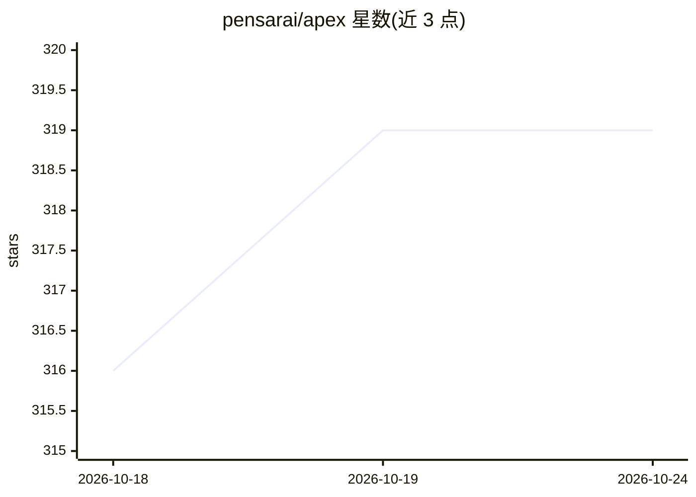

# pensarai/apex

⭐ 319 · TypeScript · Apache-2.0 · 推送 2026-10-23 · [GitHub](https://github.com/pensarai/apex) · [官网](https://pensar.dev) · 组织维护

**终端内运行的自主 agent 渗透测试工具（黑白盒）**

Pensar Apex 是在终端中运行的 AI 渗透测试工具：以自主 agent 执行黑盒/白盒测试，支持探索、推理并产出带严重度评分、证据与修复建议的漏洞发现。提供 TUI 与 headless CLI 两种模式，可集成 CI/CD；支持自定义 OpenAI 兼容推理端点、W&B Weave 追踪与 OpenTelemetry 观测，可选 Kali Linux Docker 容器预配置测试工具。面向开发者在 PR 合并前自查与安全工程师的大面积攻击面测试，仅限授权安全测试。

## 筛选速览

| 维度 | 判定 | 备注 |
|---|---|---|
| AI 角色 | `ai-native` | 本体是模型或模型工具 |
| 许可风险 | `permissive` | Apache-2.0 |
| 部署形态 | `self-host` | docker 或自建部署 |
| 模型依赖 | — | README 未给出锁定关系 |
| 硬件要求 | — | 无带数字的原话,不猜 |
| 安装摩擦 | `low` | 无编译、无系统依赖或容器化 |
| 成熟度 | — | 结构信号不足 |

## 能力要点

- 自主 agent 执行黑盒/白盒渗透测试，输出带严重度与证据的发现
- TUI 与 headless CLI 双模式，可接入 CI/CD 与 evalgate
- 支持 OpenAI 兼容自定义推理端点（customProviders / APEX_CUSTOM_PROVIDERS）
- 可选 Kali Linux Docker 容器预配置渗透测试工具
- W&B Weave 步级追踪与 OpenTelemetry span 输出

## 适用场景

- 在 PR 合并前运行 /pentest 及时发现漏洞
- 安全工程师对大攻击面部署 agent 群测试与 exploit 链验证
- 在 CI/CD 中以 headless CLI 自动化渗透测试
- 在预配置渗透工具的 Kali 容器中运行测试

## 场景标签

`网络安全` · 领域:学习与行业

## 证据(README 行号)

> L3: AI-powered penetration testing using autonomous agents — directly in your terminal. Run blackbox and whitebox pentes
> L24: - Deploy agent-driven swarm testing across large attack surfaces

## 星数曲线

2026-10-18 316 → 2026-10-24 319（+3）

---
*卡片 v1 · prompt 1.4 · 生成 2026-10-21 · 置信度 high · 依据 README sha `cd516f83a02e` · [字段定义](../../DATASET.md)*
