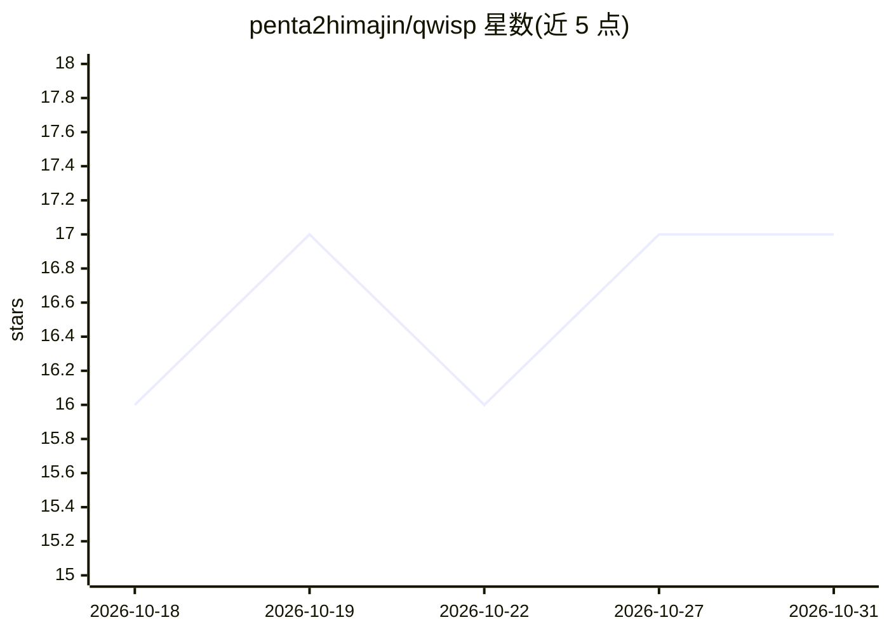

# penta2himajin/qwisp

⭐ 17 · Swift · Apache-2.0 · 推送 2026-10-18 · [GitHub](https://github.com/penta2himajin/qwisp) · 个人维护

**Apple Silicon 上 Qwen3.6-35B MoE 模型的本地推理服务器与 CLI**

单模型专用本地推理引擎：针对 Qwen3.6-35B-A3B (MoE) 提供 OpenAI 兼容的 HTTP API（/v1/chat/completions SSE 流式、/v1/models）与 qwisp chat CLI。解码核心 Seedless 在 MLX 之上直接运行 raw Metal 命令缓冲，运行时 Tell 负责投机解码与调度；strict 模式可逐位复现量化贪心 token 流，bolt 模式在闪存流式加载下更快。支持函数调用、reasoning_content 分离、采样参数。RAM<32GB 机器可从闪存流式加载专家，16GB 为交互使用下限。限制：单模型、n>1 与 logprobs 不支持；多数性能数据来自单台开发机。

## 筛选速览

| 维度 | 判定 | 备注 |
|---|---|---|
| AI 角色 | `ai-ecosystem` | LLM/agent 周边工具 |
| 许可风险 | `permissive` | Apache-2.0 |
| 部署形态 | `None` |  |
| 模型依赖 | — | README 未给出锁定关系 |
| 硬件要求 | — | 无带数字的原话,不猜 |
| 安装摩擦 | `medium` | 含编译或系统依赖之一 |
| 成熟度 | — | 结构信号不足 |

## 能力要点

- OpenAI 兼容 API（SSE 流式）+ CLI，支持函数调用与投机采样
- strict 模式逐位复现量化贪心 token 流（可选无损）
- MoE 专家可从闪存流式加载，35B 模型可运行于 16GB RAM 的 Mac
- Homebrew 安装自包含二进制，macOS 14+ Apple Silicon 专用

## 适用场景

- 在 Mac 上本地运行 Qwen3.6-35B 并通过 OpenAI 客户端调用
- RAM 受限的 Mac 上流式运行 MoE 大模型
- 用 qwisp benchtest 测评本机解码速度并回报社区数据

## 场景标签

`推理引擎` · 领域:训练与推理

## 证据(README 行号)

> L3: Fast, optionally-lossless local inference for **Qwen3.6-35B-A3B (MoE)** on Apple Silicon,
> L6: Qwisp is a single-model-specialised engine. Its decode core, **Seedless**, runs raw Metal

## 星数曲线

2026-10-18 16 → 2026-10-31 17（+1）

---
*卡片 v1 · prompt 1.4 · 生成 2026-10-29 · 置信度 high · 依据 README sha `5378358f879a` · [字段定义](../../DATASET.md)*
