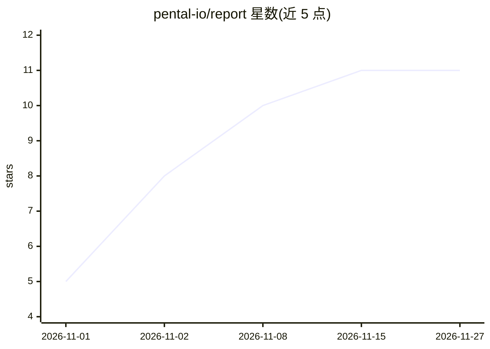

# pental-io/report

⭐ 11 · JavaScript · AGPL-3.0 · 推送 2026-11-25 · [GitHub](https://github.com/pental-io/report) · [官网](https://pental.io/report) · 组织维护

**渗透测试团队自托管的漏洞报告编写与 PDF/Word 交付平台**

自托管的开源渗透测试报告系统：围绕 engagement（项目）管理客户、测试日历、阶段、检查清单与 runbook（含 OSSTMM、PTES、OWASP WSTG/ASVS、MITRE ATT&CK 等方法论的 22 套检查清单与 21 套 runbook），支持自定义 finding 字段、CVSS 3.1/4.0 打分、复测记录与 findings 库（预置 490 条）。报告可输出内置 PDF 或基于自有 Word 模板的 Document Builder，支持企业自有品牌（logo、配色、字体）。AI 部分使用用户自己的 key 或自有硬件，从证据起草 finding 字段与总结。一条安装脚本在 Docker 中运行，附带自身 PostgreSQL，通过 Tailscale 或自有域名以 HTTPS 提供团队访问。

## 筛选速览

| 维度 | 判定 | 备注 |
|---|---|---|
| AI 角色 | `ai-enhanced` | 去掉 AI 部分产品仍成立 |
| 许可风险 | `viral` | AGPL-3.0 |
| 部署形态 | `desktop` | 安装包/桌面程序 |
| 模型依赖 | local-ok | 支持本地模型 |
| 硬件要求 | — | 无带数字的原话,不猜 |
| 安装摩擦 | `low` | 无编译、无系统依赖或容器化 |
| 成熟度 | — | 结构信号不足 |

## 能力要点

- 22 套方法论检查清单与 21 套 runbook 库（OSSTMM、PTES、OWASP、MITRE ATT&CK 等）
- 490 条预置 finding 库，覆盖 21 个领域，含 CVSS 评分与 CWE
- 内置 PDF 报告与自有 Word 模板的 Document Builder，支持企业品牌定制
- AI 起草功能基于用户自己的 key 或自有硬件，提示词可改写

## 适用场景

- 渗透测试团队统一管理项目与漏洞发现并交付客户报告
- 用自有 Word 模板输出带公司品牌的渗透测试报告
- 在 Tailscale 内网内让团队协作编写 finding 与复测记录
- 从测试证据用自有 AI key 起草漏洞描述与总结

## 场景标签

`网络安全` `AI 写作` · 领域:内容生成

## 证据(README 行号)

> L13:  Pental Report is free, open-source penetration test reporting that runs on your own server.
> L161: - **On your own key or your own hardware**: Generate all from evidence, a button on every field, instructions for 

## 星数曲线

2026-11-01 5 → 2026-11-27 11（+6）

---
*卡片 v1 · prompt 1.4 · 生成 2026-11-18 · 置信度 high · 依据 README sha `f823d9b358bd` · [字段定义](../../DATASET.md)*
