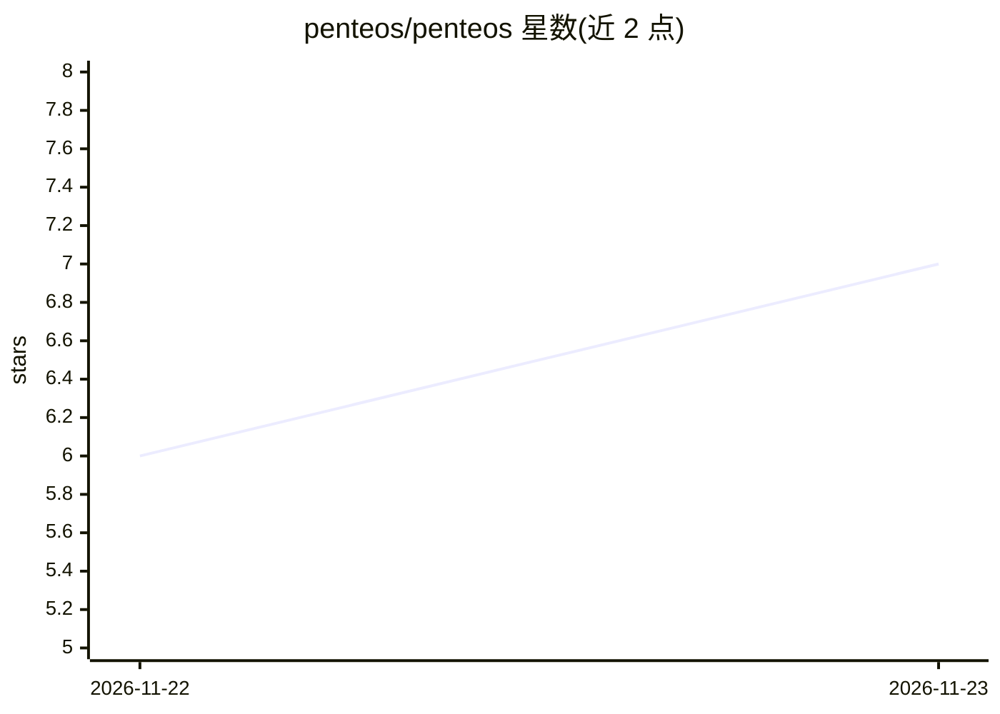

# penteos/penteos

⭐ 7 · TypeScript · AGPL-3.0 · 推送 2026-11-18 · [GitHub](https://github.com/penteos/penteos) · [官网](https://penteos.com) · 组织维护

**给渗透测试者的 AI 测试工作台：侦察到报告一站完成**

面向渗透测试的桌面工作台（Electron，Linux/macOS），将 scope、侦察、真实工具、拦截代理、证据、发现与客户报告放在同一项目中。其 AI agent「Maestro」执行测试，内置三条约束：发送给模型前对客户数据做稳定假名脱敏并在回程还原；scope 由核心强制校验（主机/端口/时间窗/风险上限审批）；每条发现需引用原始输出行并由独立 verifier 复现，未经用户批准不进入报告。支持多种模型接入与 MCP 客户端驱动。

## 筛选速览

| 维度 | 判定 | 备注 |
|---|---|---|
| AI 角色 | `ai-native` | 本体是模型或模型工具 |
| 许可风险 | `viral` | AGPL-3.0 |
| 部署形态 | `desktop` | 安装包/桌面程序 |
| 模型依赖 | local-ok | 支持本地模型 |
| 硬件要求 | — | 无带数字的原话,不猜 |
| 安装摩擦 | `low` | 无编译、无系统依赖或容器化 |
| 成熟度 | — | 结构信号不足 |

## 能力要点

- 数据脱敏管道：17 类数据稳定假名化，模型读不到真实值
- scope 由核心强制，非依赖模型遵守，超风险动作需用户批准
- 发现必须引用原始输出证据并经独立 verifier 复现
- 支持 ChatGPT/DeepSeek/本地模型及任意 OpenAI 兼容 API，可被 MCP 客户端驱动

## 适用场景

- 对授权目标做侦察到报告的全流程渗透测试
- 要求客户数据不发送给 LLM 的合规测试场景
- 用本地模型离线运行 agent，数据不出本机
- 生成带证据链的技术与高管版客户报告（Word/PDF/HTML/Markdown）

## 场景标签

`网络安全` · 领域:学习与行业

## 证据(README 行号)

> L24: Penteos is a desktop workbench for penetration testing. Scope, recon, real tools, an intercepting
> L25: proxy, evidence, findings and the client report live in one project. Its AI agent, the **Maestro**,
> L60: ### 1. Your client's data is masked before the AI reads it

## 星数曲线

2026-11-22 6 → 2026-11-23 7（+1）

---
*卡片 v1 · prompt 1.4 · 生成 2026-11-22 · 置信度 mid · 依据 README sha `f86245ccb7f2` · [字段定义](../../DATASET.md)*
