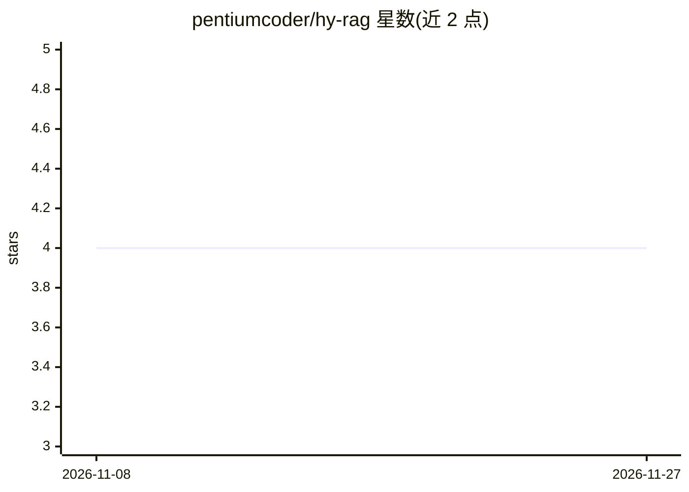

# pentiumcoder/hy-rag

⭐ 4 · Python · MIT · 推送 2026-11-24 · [GitHub](https://github.com/pentiumcoder/hy-rag) · 个人维护

**内部文档本地 RAG 问答系统：混合检索+引用核验**

面向内部文档的问答系统：BM25 与稠密检索并行，经 RRF 融合与 cross-encoder 重排后由 LLM 回答，每句附引用并由另一家族的模型逐句核验，文档无法回答时明确拒答而非猜测。检索、索引、评估全部可本地运行（Ollama），默认无需 API key。附带 55 题评估集与仪表盘/API。限制：默认 CPU 路径每答约 45 秒，测试集为作者自拟，评估打分模型存在误判。

## 筛选速览

| 维度 | 判定 | 备注 |
|---|---|---|
| AI 角色 | `ai-native` | 本体是模型或模型工具 |
| 许可风险 | `permissive` | MIT |
| 部署形态 | `self-host` | docker 或自建部署 |
| 模型依赖 | local-ok | 支持本地模型 |
| 硬件要求 | — | 无带数字的原话,不猜 |
| 安装摩擦 | `low` | 无编译、无系统依赖或容器化 |
| 成熟度 | — | 结构信号不足 |

## 能力要点

- BM25+稠密检索、RRF 融合、cross-encoder 重排
- 每句引用经第二模型核验，不支持则划线降分
- 三级拒答机制，8 个不可回答问题全部拒答
- 55 题评估集，hyrag eval 命令可复现

## 适用场景

- 对内部 Markdown/PDF/HTML 文档做带引用的问答
- 在无外网、无 API key 的环境本地部署 RAG
- 对比不同检索与分块策略的召回效果

## 场景标签

`RAG` `文档问答` `模型评测` · 领域:评测与运维

## 证据(README 行号)

> L3: A question-answering system for internal documentation. It searches with BM25 and embeddings together, reranks with 
> L5: Everything runs locally on Ollama. No API keys, no per-query cost.

## 星数曲线

2026-11-08 4 → 2026-11-27 4（+0）

---
*卡片 v1 · prompt 1.4 · 生成 2026-11-21 · 置信度 high · 依据 README sha `93866cc930ac` · [字段定义](../../DATASET.md)*
