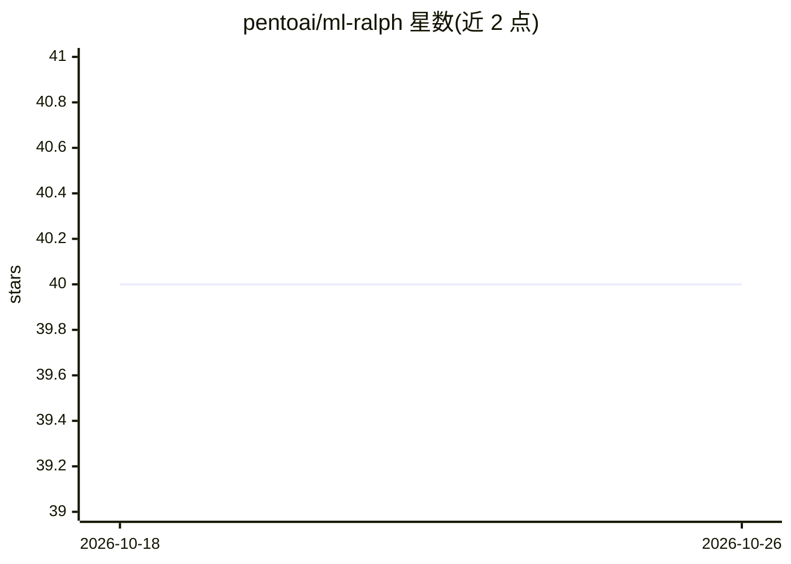

# pentoai/ml-ralph

⭐ 40 · TypeScript · MIT · 推送 2026-10-17 · [GitHub](https://github.com/pentoai/ml-ralph) · 组织维护

**基于 Claude Code 的自主 ML 实验代理，带终端界面**

以终端 TUI 形式运行的自主机器学习工程代理：用户通过 PRD 定义目标，代理自主拆解并执行 story，运行实验、记录指标并跨迭代积累结构化学习。核心机制为四阶段认知循环（理解→策略→执行→反思），并将战略撤退（卡住时回到理解阶段）作为一等概念。运行依赖 Bun v1.0+、tmux 与已认证的 Claude Code CLI，通过 bunx 一条命令启动。

## 筛选速览

| 维度 | 判定 | 备注 |
|---|---|---|
| AI 角色 | `ai-ecosystem` | LLM/agent 周边工具 |
| 许可风险 | `permissive` | MIT |
| 部署形态 | `None` |  |
| 模型依赖 | locked-api |  |
| 硬件要求 | — | 无带数字的原话,不猜 |
| 安装摩擦 | `low` | 无编译、无系统依赖或容器化 |
| 成熟度 | — | 结构信号不足 |

## 能力要点

- PRD 定义目标后自主规划并执行实验循环
- 四阶段认知循环：理解→策略→执行→反思
- 约 70% 精力分配给理解与验证的认知框架设定
- 跨迭代积累结构化学习与指标追踪

## 适用场景

- 让代理在 ML 项目目录中自主跑实验并分析结果
- 自动化实验的规划、执行与结论验证流程
- 跨多轮迭代沉淀结构化经验教训

## 场景标签

`编码 Agent` · 领域:编码与开发

## 证据(README 行号)

> L6: An autonomous ML engineering agent with a terminal user interface. ml-ralph automates the experiment loop — planning
> L8: You define your goals through a PRD. The agent works through stories autonomously, runs experiments, tracks metrics,
> L22: - Claude Code CLI, installed and authenticated

## 星数曲线

2026-10-18 40 → 2026-10-26 40（+0）

---
*卡片 v1 · prompt 1.4 · 生成 2026-10-25 · 置信度 high · 依据 README sha `e4ae82fcc9d7` · [字段定义](../../DATASET.md)*
