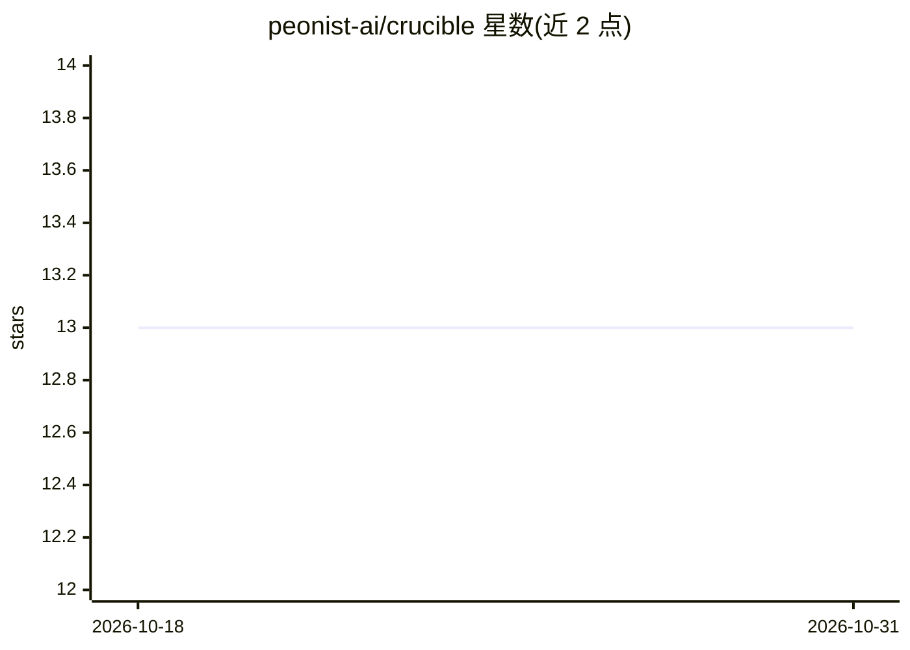

# peonist-ai/crucible

⭐ 13 · Python · Apache-2.0 · 推送 2026-10-28 · [GitHub](https://github.com/peonist-ai/crucible) · 组织维护

**MoE 大模型专家压缩工具：剪枝/合并并评测，供消费级硬件本地推理**

面向开发者的 Mixture-of-Experts 模型压缩工具包：按校准数据为每个专家打分（REAP 及多种打分变体），剪除低贡献专家，输出 compressed-tensors 量化权重供 vLLM/llama-server 等本地推理服务加载。分为 crucible（压缩）与 crucible-bench（评测，驱动任意 OpenAI 兼容端点、含沙箱化代码执行）两个独立包，经 uv workspace 安装。通过 registry 声明支持 Gemma 4、Qwen 3.5/3.6、Qwen3、Mixtral 等架构；REAM 合并路径标注为实验性且在 Gemma 4 上损坏。README 自述处于早期：仅验证一个模型家族与一种方法。

## 筛选速览

| 维度 | 判定 | 备注 |
|---|---|---|
| AI 角色 | `ai-ecosystem` | LLM/agent 周边工具 |
| 许可风险 | `permissive` | Apache-2.0 |
| 部署形态 | `self-host` | docker 或自建部署 |
| 模型依赖 | local-ok | 支持本地模型 |
| 硬件要求 | — | 无带数字的原话,不猜 |
| 安装摩擦 | `low` | 无编译、无系统依赖或容器化 |
| 成熟度 | `idea` | |

## 能力要点

- REAP 专家剪枝（router gate × activation norm 打分）及 pathfinder/task-aware/adaptive 等打分变体
- crucible-bench 自包含评测：HumanEval+/MBPP+/BFCL/IFEval/MMLU-Pro 等，结果输出结构化 JSON 供对比
- 量化输出 compressed-tensors，vLLM 原生加载；ROCm/gfx1151 上为可达 RDNA 4-bit 内核的布局
- 沙箱容器（--network none、只读 rootfs、512MB 内存上限）执行模型生成代码

## 适用场景

- 把大型 MoE 模型压缩为可在消费级硬件上运行的专家模型
- 先跑基线再对比压缩后模型在各基准上的差值
- 为特定任务校准并剪枝出领域专家模型

## 场景标签

`模型量化` `模型评测` · 领域:评测与运维

## 证据(README 行号)

> L17: Takes large Mixture-of-Experts language models and compresses them into compact specialists
> L40: |`crucible`|prunes, merges, quantizes — produces weights|torch, transformers|
> L99: `crucible-bench` is a self-contained harness — no lm-eval dependency — that drives any

## 星数曲线

2026-10-18 13 → 2026-10-31 13（+0）

---
*卡片 v1 · prompt 1.4 · 生成 2026-10-31 · 置信度 mid · 依据 README sha `301315a859c2` · [字段定义](../../DATASET.md)*
