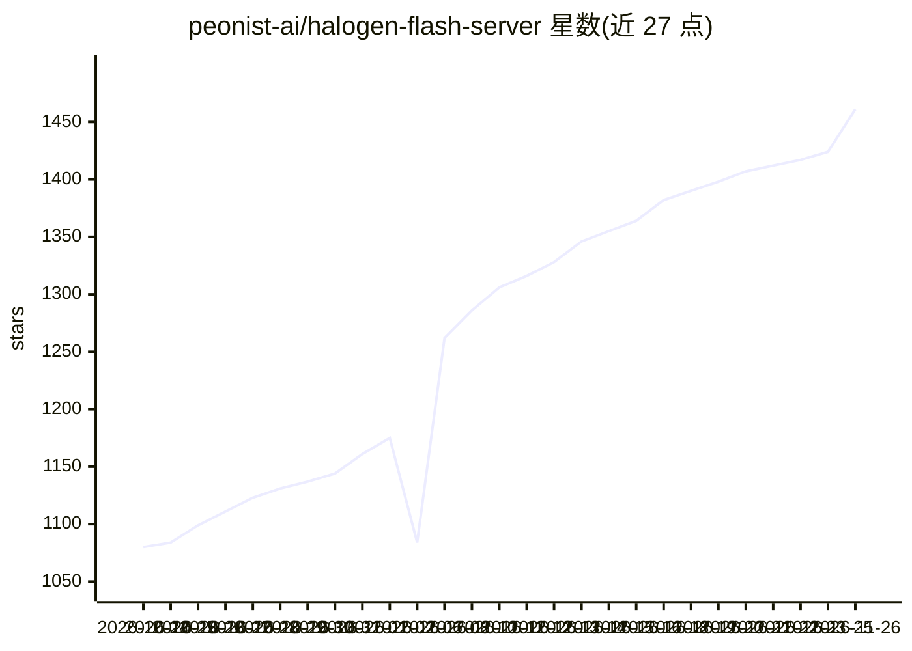

# peonist-ai/halogen-flash-server

⭐ 1,461 · Shell · NOASSERTION · 推送 2026-11-18 · [GitHub](https://github.com/peonist-ai/halogen-flash-server) · [官网](https://peonist.ai/halogen/) · 组织维护

**为开发者在 AMD Strix Halo 上本地运行 Qwen3.8 的推理服务器**

针对单一 GPU（AMD Ryzen AI Max+ 395/Strix Halo）与单一模型族（Qwen3.8-Flash-Next）编写的推理服务器：所有 kernel 为该 GPU 和模型专写，无通用运行时层。在同一端口提供 OpenAI 兼容 API 与 Anthropic Messages API，供 Codex、Claude Code 等 agent 客户端接入；附 NPU 小模型服务、Flint 预览镜像（RecursiveSI Flint 40B MoE）。限制：仅运行在指定的一块芯片上，不具可移植性；需 Docker/Podman 运行并配置 BIOS UMA carve-out。

## 筛选速览

| 维度 | 判定 | 备注 |
|---|---|---|
| AI 角色 | `ai-ecosystem` | LLM/agent 周边工具 |
| 许可风险 | `none` | NOASSERTION |
| 部署形态 | `None` |  |
| 模型依赖 | local-ok | 支持本地模型 |
| 硬件要求 | — | 无带数字的原话,不猜 |
| 安装摩擦 | `low` | 无编译、无系统依赖或容器化 |
| 成熟度 | — | 结构信号不足 |

## 能力要点

- 同一端口提供 OpenAI 兼容 API 与 Anthropic Messages API
- 支持直接读取 llama.cpp GGUF 文件，无需转换
- 温度 0 输出与串行 greedy 解码字节一致，投机解码经逐版本验证
- 并发模式下多请求获得更高总吞吐，温度 0 回复不随并发数变化

## 适用场景

- 在一台 Strix Halo 机器上为编码 agent 提供本地长上下文模型服务
- 用现有 GGUF 权重文件直接启动推理服务
- 同时供 OpenAI 与 Anthropic 协议的客户端调用本地模型

## 场景标签

`推理引擎` · 领域:训练与推理

## 证据(README 行号)

> L5: **halogen™ is the fastest way to run Qwen3.8-Flash-Next on AMD Strix Halo,
> L83: |Clients|Codex (Responses API) · Claude Code (Messages API) · agent harnesses · sessions: keep, fork, join|
> L96: podman run --rm -p 8731:8731 \

## 星数曲线

2026-10-24 1,080 → 2026-11-26 1,461（+381）

---
*卡片 v1 · prompt 1.4 · 生成 2026-11-23 · 置信度 high · 依据 README sha `a0a95131dac5` · [字段定义](../../DATASET.md)*
