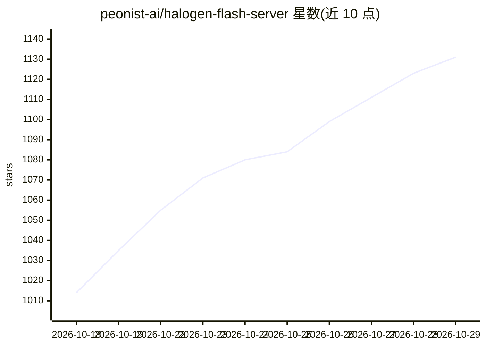

# peonist-ai/halogen-flash-server

⭐ 1,131 · Shell · NOASSERTION · 推送 2026-10-27 · [GitHub](https://github.com/peonist-ai/halogen-flash-server) · [官网](https://peonist.ai/halogen/) · 组织维护

**在 AMD Strix Halo 上运行 Qwen3.8-Flash-Next 的专用推理服务器**

面向 AMD Strix Halo (gfx1151) 单一 GPU 与 Qwen3.8-Flash-Next 单一模型家族编写的 LLM 推理服务引擎，无通用运行时或可移植层。通过 OpenAI 兼容 API 提供服务，支持 Codex（Responses API）与 Claude Code（Messages API）等客户端，提供会话保持/分叉/合并、1M 上下文、KV 缓存池、磁盘缓存、classify 端点；投机解码在 temperature 0 下输出与串行贪心解码逐字节一致；0.7.0 起可直接打开该模型的 llama.cpp GGUF 文件，无需转换。以容器镜像（podman/docker）方式分发，要求将 BIOS UMA 显存分配设为最小值以使用主机内存。

## 筛选速览

| 维度 | 判定 | 备注 |
|---|---|---|
| AI 角色 | `ai-ecosystem` | LLM/agent 周边工具 |
| 许可风险 | `none` | NOASSERTION |
| 部署形态 | `None` |  |
| 模型依赖 | local-ok | 支持本地模型 |
| 硬件要求 | — | 无带数字的原话,不猜 |
| 安装摩擦 | `low` | 无编译、无系统依赖或容器化 |
| 成熟度 | — | 结构信号不足 |

## 能力要点

- 针对 Strix Halo 单 GPU 与单一模型家族编写全部内核
- OpenAI 兼容 API，支持 Codex/Claude Code 等 agent 客户端
- temperature 0 下投机解码输出与串行贪心解码逐字节一致
- 可直接打开该模型的 llama.cpp GGUF 文件，无需转换

## 适用场景

- 在 Strix Halo 机器上本地部署 Qwen3.8-Flash-Next 为 agent 提供推理服务
- 长上下文（最高 1M）编码 agent 会话的低延迟服务
- 复用已有的该模型 GGUF 权重文件直接运行

## 场景标签

`推理引擎` · 领域:训练与推理

## 证据(README 行号)

> L5: **halogen™ is the fastest way to run Qwen3.8-Flash-Next on AMD Strix Halo,
> L9: Every kernel is written for this one GPU and this one model family. No
> L98: podman run --rm -p 8731:8731 \

## 星数曲线

2026-10-18 1,014 → 2026-10-29 1,131（+117）

---
*卡片 v1 · prompt 1.4 · 生成 2026-10-21 · 置信度 high · 依据 README sha `e047fbf7ec42` · [字段定义](../../DATASET.md)*
