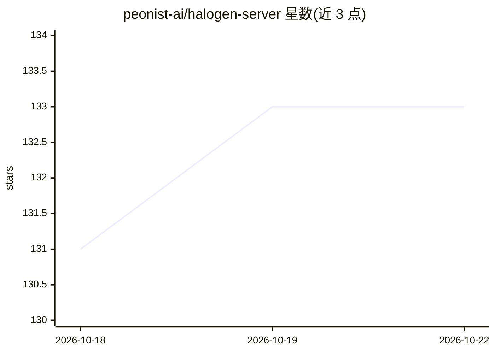

# peonist-ai/halogen-server

⭐ 133 · Python · NOASSERTION · 推送 2026-09-14 · [GitHub](https://github.com/peonist-ai/halogen-server) · [官网](https://huggingface.co/peonist-ai/halogen-qwen3.8-27b) · 组织维护

**在 AMD Strix Halo 上运行 Qwen3.8-27B 的专用推理服务**

为 gfx1151（Strix Halo）与 Qwen3.8-27B 单一模型家族编写的 HIP 推理引擎，以容器形式发布，提供 OpenAI 兼容 API（/v1/chat/completions、流式、工具调用、reasoning_effort 控制）。核心机制：字节级等价于贪心解码的投机采样（三种 drafter 可选）、262,144 token 原生上下文（Gated DeltaNet 使多数层无 KV cache）、prompt cache 与最多 8 并发的批量解码。镜像不含权重（35.9 GB 需另行下载或通过 HALOGEN_DOWNLOAD 自动获取）。限制：仅支持该 GPU 与该模型家族；批量解码默认关闭。

## 筛选速览

| 维度 | 判定 | 备注 |
|---|---|---|
| AI 角色 | `ai-ecosystem` | LLM/agent 周边工具 |
| 许可风险 | `none` | NOASSERTION |
| 部署形态 | `library` | 以包/库形式分发 |
| 模型依赖 | — | README 未给出锁定关系 |
| 硬件要求 | — | 无带数字的原话,不猜 |
| 安装摩擦 | `low` | 无编译、无系统依赖或容器化 |
| 成熟度 | — | 结构信号不足 |

## 能力要点

- OpenAI 兼容端点（端口 8731），支持流式、工具调用与种子采样
- 投机解码输出与串行贪心解码逐字节一致，每次发布实测验证
- 262,144 token 原生上下文，48/64 层无 KV cache
- 内置 bench 与 sweep 基准工具，--json 输出机器可读结果

## 适用场景

- 在 Strix Halo（Ryzen AI Max+ 395）设备上本地部署 Qwen3.8-27B 服务
- 用现有 OpenAI 客户端对接本地推理端点
- 处理 32K 级长提示词并复现项目发布的基准数字

## 场景标签

 · 领域:LLM 推理基础设施

## 证据(README 行号)

> L8: Every kernel is written for this one GPU and this one model family. No
> L230: **OpenAI-compatible API** — `/v1/chat/completions`, `/v1/completions`,

## 星数曲线

2026-10-18 131 → 2026-10-22 133（+2）

---
*卡片 v1 · prompt 1.4 · 生成 2026-10-22 · 置信度 mid · 依据 README sha `9a8d7b83f380` · [字段定义](../../DATASET.md)*
