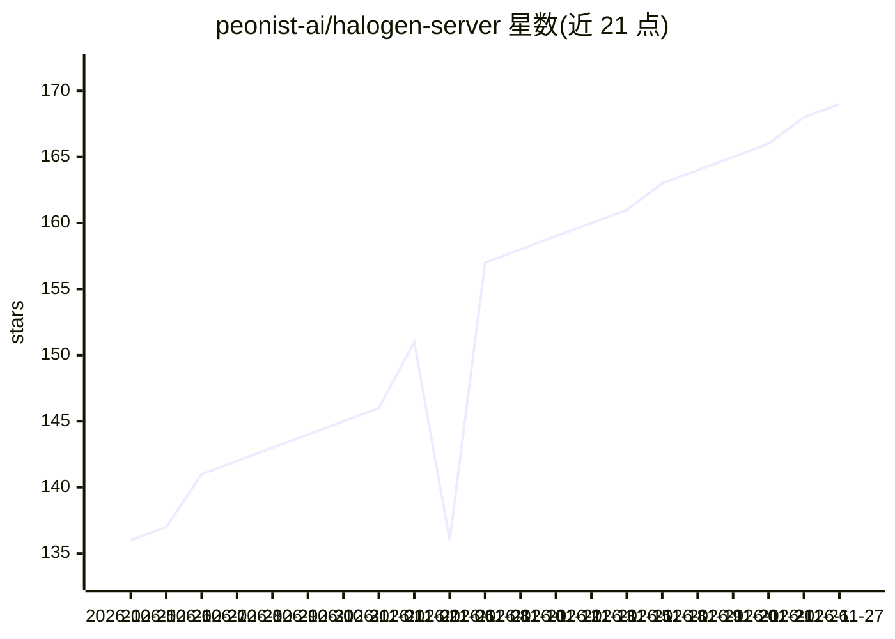

# peonist-ai/halogen-server

⭐ 169 · Python · NOASSERTION · 推送 2026-11-26 · [GitHub](https://github.com/peonist-ai/halogen-server) · [官网](https://huggingface.co/peonist-ai/halogen-qwen3.8-27b) · 组织维护

**在 AMD Strix Halo GPU 上本地服务 Qwen3.8-27B 的推理服务器**

针对单一 GPU（Strix Halo / gfx1151）与单一模型家族（Qwen3.8-27B）编写的推理引擎，内核按该硬件定制，不含通用可移植层。以容器镜像分发（约 3.5 GB，不含权重），权重经 Hugging Face 下载挂载（约 35.9 GB），或通过环境变量首次启动自动下载。提供 OpenAI 兼容 API（:8731），支持投机解码（三种 drafter 可选且输出与串行解码逐字节一致）、262,144 token 上下文、prompt 缓存、批处理解码与工具调用；默认不发起任何外联网络连接。仅在该单一硬件上运行。

## 筛选速览

| 维度 | 判定 | 备注 |
|---|---|---|
| AI 角色 | `ai-ecosystem` | LLM/agent 周边工具 |
| 许可风险 | `none` | NOASSERTION |
| 部署形态 | `library` | 以包/库形式分发 |
| 模型依赖 | — | README 未给出锁定关系 |
| 硬件要求 | — | 无带数字的原话,不猜 |
| 安装摩擦 | `low` | 无编译、无系统依赖或容器化 |
| 成熟度 | — | 结构信号不足 |

## 能力要点

- 字节级一致的投机解码，三种 drafter（DFlash2/MTP/serial）按请求选择
- 262,144 token 原生上下文，多数层无 KV cache（Gated DeltaNet O(1) 状态）
- OpenAI 兼容端点：chat/completions、streaming、tool calling、reasoning-effort 控制
- 未设置下载变量时容器零外联（无遥测、无许可检查）

## 适用场景

- 在 Strix Halo（Ryzen AI Max+ 395）设备上本地运行 Qwen3.8-27B
- 为本地应用提供 OpenAI 兼容的推理端点
- 用自带 bench/sweep 工具对该硬件做推理性能基准测试

## 场景标签

`推理引擎` · 领域:训练与推理

## 证据(README 行号)

> L13: **halogen™ is the fastest way to run Qwen3.8-27B on AMD Strix Halo, at higher
> L45: An OpenAI-compatible endpoint comes up on `:8731`.
> L238: **OpenAI-compatible API** — `/v1/chat/completions`, `/v1/completions`,

## 星数曲线

2026-10-25 136 → 2026-11-27 169（+33）

---
*卡片 v1 · prompt 1.4 · 生成 2026-11-27 · 置信度 mid · 依据 README sha `ad38cf2a7483` · [字段定义](../../DATASET.md)*
