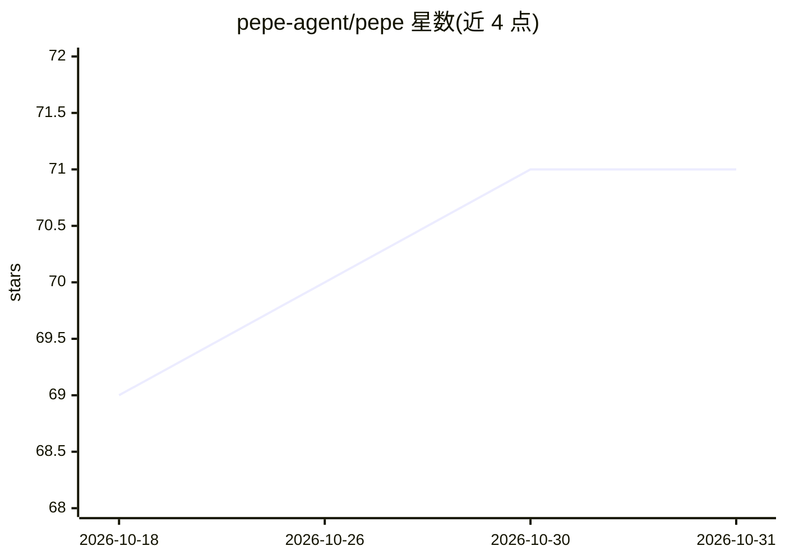

# pepe-agent/pepe

⭐ 71 · Elixir · MIT · 推送 2026-10-29 · [GitHub](https://github.com/pepe-agent/pepe) · [官网](https://pepe-agent.com) · 个人维护

**Elixir/OTP 自托管 AI agent 运行时：定义 agent 并执行工具调用循环**

用 Elixir/OTP 实现的 AI agent 运行时：每个对话一个轻量进程、监督机制隔离崩溃，通过 OpenAI Chat Completions 协议接入任意兼容模型（OpenAI、Groq、DeepSeek、Ollama、vLLM 等）。暴露 Web 仪表盘（Phoenix LiveView）、OpenAI 兼容 HTTP API、WebSocket、Telegram/WhatsApp、代码编辑器（ACP）与 CLI 等多种界面。提供目标驱动运行（独立 reviewer 判定完成）、语音转写、定时任务、MCP、插件与用量计量。曾为内部专有工具后开源，作者声明多数 provider 未验证。

## 筛选速览

| 维度 | 判定 | 备注 |
|---|---|---|
| AI 角色 | `ai-ecosystem` | LLM/agent 周边工具 |
| 许可风险 | `permissive` | MIT |
| 部署形态 | `self-host` | docker 或自建部署 |
| 模型依赖 | local-ok | 支持本地模型 |
| 硬件要求 | — | 无带数字的原话,不猜 |
| 安装摩擦 | `low` | 无编译、无系统依赖或容器化 |
| 成熟度 | — | 结构信号不足 |

## 能力要点

- 每对话独立进程、监督隔离崩溃的 OTP 架构
- 任意 OpenAI 兼容模型零代码改动接入
- goal 模式由独立 reviewer 模型判定完成标准
- 多界面：LiveView 仪表盘、OpenAI 兼容 API、Telegram/WhatsApp、CLI

## 适用场景

- 自托管一个可从 Telegram/WhatsApp 对话的 agent
- 把 agent 嵌入自己的 SaaS，按项目隔离租户并计量计费
- 通过 OpenAI SDK 指向 Pepe 的 HTTP API 复用现有代码

## 场景标签

`Agent 框架` · 领域:Agent 开发

## 证据(README 行号)

> L5:  An Elixir/OTP AI agent runtime. Define agents, connect to any model, and run a tool-calling loop.
> L51: Everything talks to providers over the **OpenAI Chat Completions** protocol, so
> L52: OpenAI, OpenRouter, Together, Groq, DeepSeek,

## 星数曲线

2026-10-18 69 → 2026-10-31 71（+2）

---
*卡片 v1 · prompt 1.4 · 生成 2026-10-24 · 置信度 high · 依据 README sha `2072af8ef61a` · [字段定义](../../DATASET.md)*
