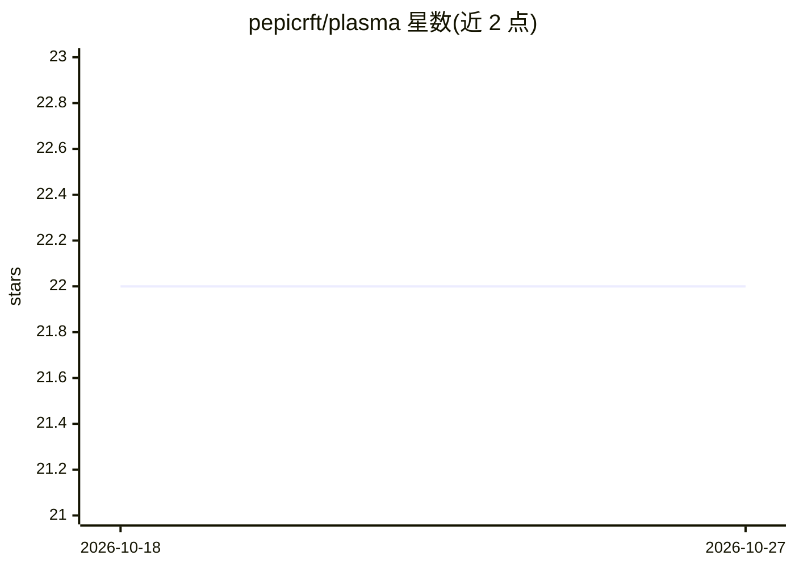

# pepicrft/plasma

⭐ 22 · TypeScript · MPL-2.0 · 推送 2026-03-01 · [GitHub](https://github.com/pepicrft/plasma) · [官网](https://plasma.dev) · 个人维护

**AI 驱动的本地优先 iOS/Android 应用构建工具**

基于 Electron 的桌面应用，面向 iOS 和 Android 应用开发，定位为 local-first、AI 驱动的应用构建工具。动机部分说明其思路：平台原生编辑器（Xcode、Android Studio）以渐进方式加入 AI 功能，受既有 UI 与工作流约束，该项目尝试重新思考应用开发，使传统 IDE 特性与直接代码编辑变为可选而非核心。受 Tidewave 启发。README 仅给出开发说明：用 mise 安装依赖、npm 运行与打包，未描述面向最终用户的使用方式。

## 筛选速览

| 维度 | 判定 | 备注 |
|---|---|---|
| AI 角色 | `ai-native` | 本体是模型或模型工具 |
| 许可风险 | `permissive` | MPL-2.0 |
| 部署形态 | `None` |  |
| 模型依赖 | — | README 未给出锁定关系 |
| 硬件要求 | — | 无带数字的原话,不猜 |
| 安装摩擦 | `low` | 无编译、无系统依赖或容器化 |
| 成熟度 | — | 结构信号不足 |

## 能力要点

- local-first、AI 驱动的 iOS/Android 应用构建工具
- 基于 Electron 的桌面应用
- 将传统 IDE 特性与直接代码操作定位为可选而非核心

## 适用场景

- 通过 AI 交互方式构建移动应用原型
- 在不想直接编写代码的流程中开发 iOS/Android 应用

## 场景标签

`编码 Agent` · 领域:编码与开发

## 证据(README 行号)

> L6: A local-first, AI-powered tool for building iOS and Android apps.
> L10: Platform-native editors like Xcode and Android Studio are adding AI features incrementally, but they're constrained

## 星数曲线

2026-10-18 22 → 2026-10-27 22（+0）

---
*卡片 v1 · prompt 1.4 · 生成 2026-10-27 · 置信度 mid · 依据 README sha `1cf796b7c717` · [字段定义](../../DATASET.md)*
