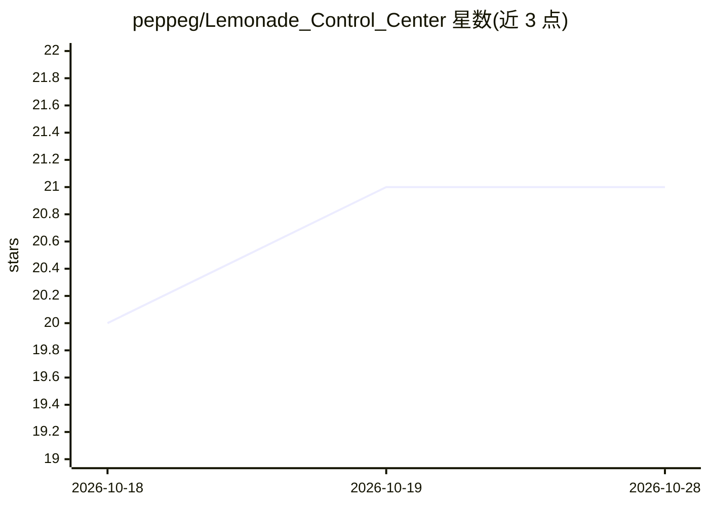

# peppeg/Lemonade_Control_Center

⭐ 21 · Python · Apache-2.0 · 推送 2026-08-27 · [GitHub](https://github.com/peppeg/Lemonade_Control_Center) · 个人维护

**Lemonade 推理服务器的 Linux 图形运维控制台**

面向 Linux 推理服务器/工作站上运行 Lemonade 的独立非官方浏览器端运维控制台，非聊天界面。功能包括：仪表盘汇总服务器健康与硬件压力、模型下载/加载/卸载管理、工作流配置档与默认值、Bench Lab 跨模型/配置对比、日志统计（TTFT/吞吐/Token 数）、主机监控（RAM/CPU/AMD GPU 温度/llama-server 进程）、诊断报告与 Run Evidence 存证、Hugging Face 引导式模型拉取与冒烟测试。默认绑定 127.0.0.1，删除与重启操作需显式环境变量开启。

## 筛选速览

| 维度 | 判定 | 备注 |
|---|---|---|
| AI 角色 | `ai-ecosystem` | LLM/agent 周边工具 |
| 许可风险 | `permissive` | Apache-2.0 |
| 部署形态 | `self-host` | docker 或自建部署 |
| 模型依赖 | — | README 未给出锁定关系 |
| 硬件要求 | — | 无带数字的原话,不猜 |
| 安装摩擦 | `low` | 无编译、无系统依赖或容器化 |
| 成熟度 | `idea` | |

## 能力要点

- 仪表盘与主机监控：RAM/CPU/AMD GPU 温度/llama-server 进程/systemd 服务状态
- Smoke Test 发送真实补全请求并保留可检查的运行证据（可导出 JSON/Markdown）
- Bench Lab 跨模型/配置档运行编码 agent 套件并导出对比报告
- 引导式 Hugging Face 模型拉取：展示 GGUF 变体与内存估算，由 Lemonade 执行下载

## 适用场景

- 远程通过 SSH 隧道管理无显示器的 Lemonade 推理主机
- 记录并复现成功的模型/运行时配置组合
- 诊断推理服务器故障并生成可下载的支持包

## 场景标签

`LLM 可观测性` · 领域:评测与运维

## 证据(README 行号)

> L12: LCC is an unofficial guided operator console for Lemonade. It is not a replacement for the official Lemonade Web UI
> L26: LCC exists for a different workflow: operating Lemonade as the backend for local AI tools, coding agents, and Linux

## 星数曲线

2026-10-18 20 → 2026-10-28 21（+1）

---
*卡片 v1 · prompt 1.4 · 生成 2026-10-28 · 置信度 mid · 依据 README sha `6283a60e4282` · [字段定义](../../DATASET.md)*
