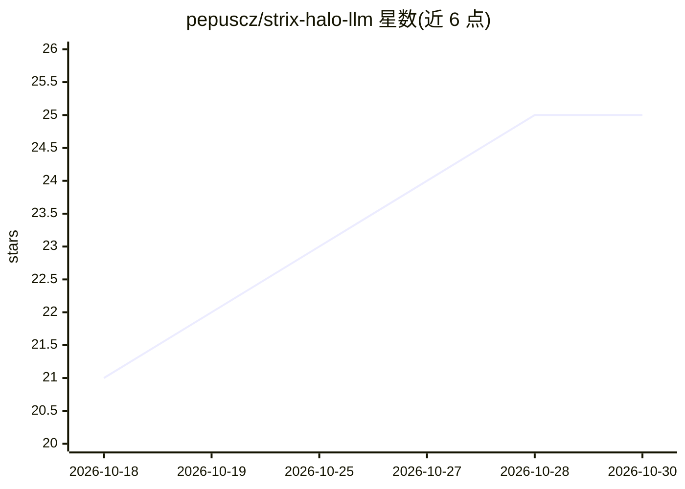

# pepuscz/strix-halo-llm

⭐ 25 · Python · MIT · 推送 2026-10-29 · [GitHub](https://github.com/pepuscz/strix-halo-llm) · 个人维护

**AMD Strix Halo 上本地运行 Qwen/DeepSeek 的 Ansible 配方与配套基准**

面向 BOSGAME M5 / Ryzen AI Max+ 395（128 GiB 内存、Radeon 8060S）及双 RX 7900 XTX 外接显卡环境的 LLM 部署仓库：提供固定版本的 Ansible 安装配方，校验硬件与制品、构建运行时并启用本机推理服务（127.0.0.1:18109）；同时记录 DeepSeek-V4.1-Flash、GLM-5.3-Flash、Qwen3.8-Flash-Next 等模型在不同技术栈（Maya HIP、Strata HIP、llama.cpp Vulkan、ROCm）下最长 512K 上下文的令牌速度、检索测试与质量用例结果。限定了特定内核版本、ROCm 7.2.4 与磁盘空间要求（GLM 约 240 GB、DeepSeek 约 470 GB）。

## 筛选速览

| 维度 | 判定 | 备注 |
|---|---|---|
| AI 角色 | `ai-ecosystem` | LLM/agent 周边工具 |
| 许可风险 | `permissive` | MIT |
| 部署形态 | `None` |  |
| 模型依赖 | — | README 未给出锁定关系 |
| 硬件要求 | — | 无带数字的原话,不猜 |
| 安装摩擦 | `low` | 无编译、无系统依赖或容器化 |
| 成熟度 | — | 结构信号不足 |

## 能力要点

- 固定版本 Ansible 配方：校验硬件与制品、构建运行时、启用 strix-halo-inference.service
- 最长 512K（并可分配 1M）上下文的实测基准：解码/预填速度与五短语大海捞针检索
- 覆盖双 RX 7900 XTX 外接显卡与 M5 单机两种硬件形态、多种运行时栈（HIP/Vulkan/ROCm）
- 质量用例结果：DeepSeek 30/30、GLM 28/30、Qwen 30/30 通过

## 适用场景

- 在 Strix Halo 或外接双卡 AMD 平台上部署本地长上下文推理服务
- 为 512K 上下文的本地部署选型时查阅实测速度与质量数据
- 复现作者固定内核/ROCm 版本的运行环境

## 场景标签

`推理引擎` `模型评测` · 领域:评测与运维

## 证据(README 行号)

> L5: A **BOSGAME M5 / Ryzen AI Max+ 395** with **two RX 7900 XTX cards** runs DeepSeek-V4.1-Flash-1017 and GLM-5.3-Flash 
> L93: The GLM recipe needs about 240 GB free; the DeepSeek recipe needs about 470 GB. Both use kernel `7.0.0-38-generic`,

## 星数曲线

2026-10-18 21 → 2026-10-30 25（+4）

---
*卡片 v1 · prompt 1.4 · 生成 2026-10-27 · 置信度 high · 依据 README sha `ecc65aaee4c1` · [字段定义](../../DATASET.md)*
