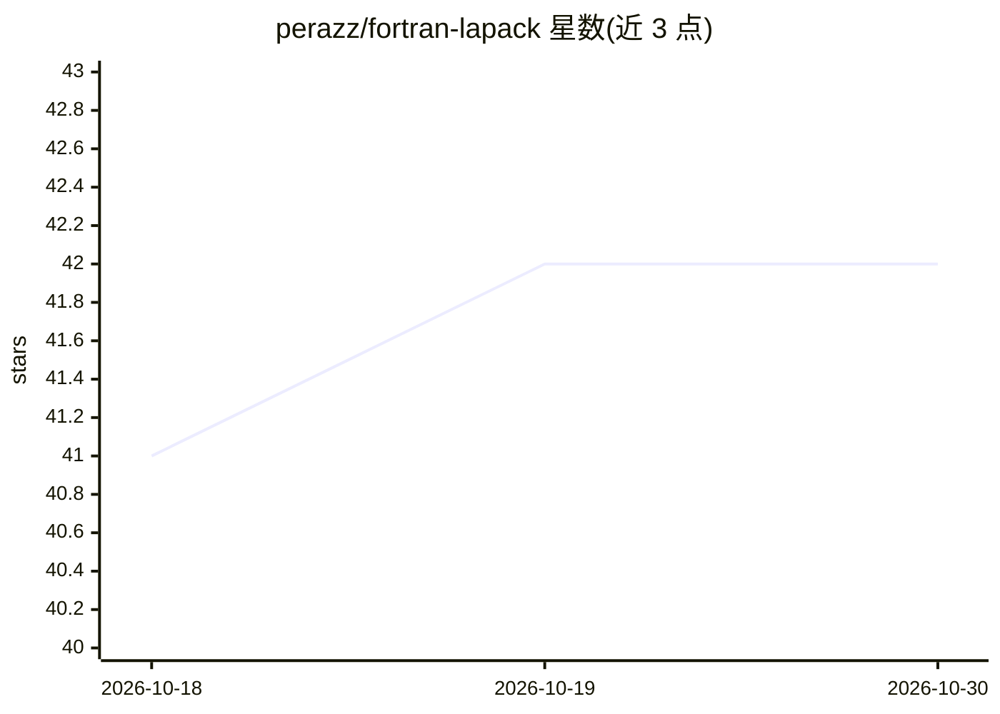

# perazz/fortran-lapack

⭐ 42 · Fortran · BSD-3-Clause · 推送 2026-10-29 · [GitHub](https://github.com/perazz/fortran-lapack) · [官网](https://perazz.github.io/fortran-lapack/) · 个人维护

**现代 Fortran 线性代数库：Cholesky 分解与特征值求解等 NumPy 风格 API**

为 Modern Fortran 提供精度无关（real/complex，32/64/128 位浮点）的高层线性代数 API，风格类似 NumPy/SciPy，底层基于 Reference-LAPACK 的现代 Fortran 实现。当前 README 文档覆盖 Cholesky 分解（chol/cholesky）、特征值分解（eig/eigh）与特征值计算（eigvals/eigvalsh），支持标准与广义特征值问题，可选原地覆写以优化性能，并通过 err 参数提供错误处理，未提供错误处理时异常触发 error stop。README 声明该库已并入 Fortran Standard Library（stdlib），建议多数用户经由 stdlib 使用，本库保留作为紧凑实现。

## 筛选速览

| 维度 | 判定 | 备注 |
|---|---|---|
| AI 角色 | `ai-ecosystem` | LLM/agent 周边工具 |
| 许可风险 | `permissive` | BSD-3-Clause |
| 部署形态 | `None` |  |
| 模型依赖 | — | README 未给出锁定关系 |
| 硬件要求 | — | 无带数字的原话,不猜 |
| 安装摩擦 | `low` | 无编译、无系统依赖或容器化 |
| 成熟度 | — | 结构信号不足 |

## 能力要点

- 精度无关 API：支持 real/complex 全部类型与 32/64/128 位浮点 kinds
- Cholesky 分解与标准/广义特征值分解（基于 LAPACK POTRF/GEEV/GGEV/SYEVD/HEEVD）
- err 可选参数错误处理，未提供时异常触发 error stop
- 已整合入 Fortran Standard Library，本库保留紧凑实现

## 适用场景

- 在 Fortran 程序中做 Cholesky 分解与特征值/特征向量计算
- 以类似 NumPy/SciPy 的接口在 Fortran 中进行矩阵分解
- 需要一个不依赖 stdlib 的紧凑 LAPACK 封装实现

## 场景标签

 · 领域:数值计算/线性代数

## 证据(README 行号)

> L2: This package provides precision-agnostic, high-level linear algebra APIs for `real` and `complex` arguments in Moder
> L4: A full and standardized implementation of the present library has been integrated into the Fortran Standard Library,

## 星数曲线

2026-10-18 41 → 2026-10-30 42（+1）

---
*卡片 v1 · prompt 1.4 · 生成 2026-10-25 · 置信度 mid · 依据 README sha `3d898de4befc` · [字段定义](../../DATASET.md)*
