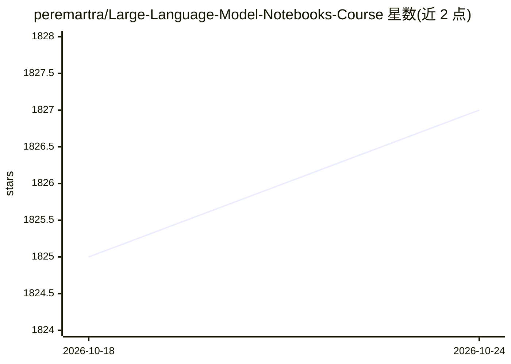

# peremartra/Large-Language-Model-Notebooks-Course

⭐ 1,827 · Jupyter Notebook · MIT · 推送 2026-09-29 · [GitHub](https://github.com/peremartra/Large-Language-Model-Notebooks-Course) · [官网](https://medium.com/@peremartra/list/large-language-models-practical-course-66b4ce5943ce) · 个人维护

**LLM 实践课程仓库：含教程文章、notebook 与小型项目**

Apress 书籍《Large Language Models》的非官方配套仓库，提供基于 OpenAI API 与 Hugging Face 库的免费动手课程。课程分三部分：技术与库（聊天机器人、提示工程、向量数据库、LangChain、RAG、微调、LoRA/QLoRA、模型评测等）、项目实践、企业方案。每课由 notebook 与 Medium 文章组成，notebook 多托管于 Colab，少数在 Kaggle，部分 notebook 需要超出 Colab 免费版内存，可自建环境或用 Colab Pro。仓库持续开发中，内容少于书籍。

## 筛选速览

| 维度 | 判定 | 备注 |
|---|---|---|
| AI 角色 | `ai-knowledge` | 知识聚合/清单类 |
| 许可风险 | `permissive` | MIT |
| 部署形态 | `None` |  |
| 模型依赖 | — | README 未给出锁定关系 |
| 硬件要求 | — | 无带数字的原话,不猜 |
| 安装摩擦 | `low` | 无编译、无系统依赖或容器化 |
| 成熟度 | `idea` | |

## 能力要点

- 课程覆盖 RAG、语义缓存、LangChain Agent、微调与 LoRA/QLoRA、BLEU/ROUGE 评测等主题
- 每课配套 notebook 与讲解文章
- notebook 托管于 Colab/Kaggle，可在线运行

## 适用场景

- 系统学习 LLM 常用库与技术并动手实践
- 参考聊天机器人、RAG、Agent 等示例项目的实现
- 了解 BLEU/ROUGE 等 LLM 评测指标用法

## 场景标签

`教程课程` · 领域:学习与行业

## 证据(README 行号)

> L15: **This practical free hands on course about Large Language models and their applications is 👷🏼in permanent developm
> L17: The course provides a hands-on experience using models from OpenAI and the Hugging Face library. We are going to se
> L23:  1- Techniques and Libraries:

## 星数曲线

2026-10-18 1,825 → 2026-10-24 1,827（+2）

---
*卡片 v1 · prompt 1.4 · 生成 2026-10-21 · 置信度 high · 依据 README sha `d064eba61c54` · [字段定义](../../DATASET.md)*
