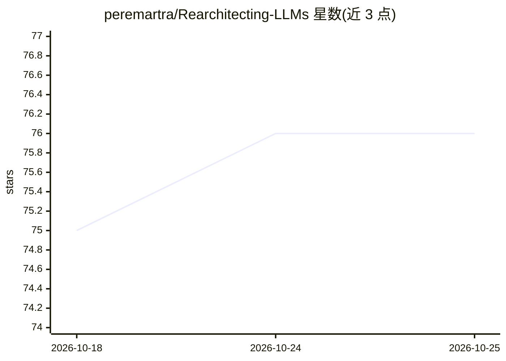

# peremartra/Rearchitecting-LLMs

⭐ 76 · Jupyter Notebook · Apache-2.0 · 推送 2026-10-19 · [GitHub](https://github.com/peremartra/Rearchitecting-LLMs) · [官网](https://hubs.la/Q040tvsK0) · 个人维护

**Manning 图书官方代码库：LLM 结构化优化（剪枝/蒸馏/注意力）教程 notebook**

《Rearchitecting LLMs》(Manning, Martra, 2026) 的官方代码仓库，提供可在 Google Colab 免费层运行的分章 notebook，讲授深度剪枝、GLU 架构宽度剪枝、知识蒸馏恢复、LoRA/DoRA 微调与量化、KV cache 与注意力优化、MoE 动态路由等技术，并介绍作者原创的 Fair Pruning（偏置感知剪枝）与 Adaptive Attention Bypass。技术应用于 Llama、Gemma、Qwen 等开源模型。notebook 可独立运行，但详细论述需配合书籍。

## 筛选速览

| 维度 | 判定 | 备注 |
|---|---|---|
| AI 角色 | `ai-knowledge` | 知识聚合/清单类 |
| 许可风险 | `permissive` | Apache-2.0 |
| 部署形态 | `None` |  |
| 模型依赖 | — | README 未给出锁定关系 |
| 硬件要求 | — | 无带数字的原话,不猜 |
| 安装摩擦 | `low` | 无编译、无系统依赖或容器化 |
| 成熟度 | — | 结构信号不足 |

## 能力要点

- 深度剪枝、GLU 宽度剪枝与知识蒸馏的完整流程 notebook
- 原创方法：Fair Pruning（神经元级去偏置）与 Adaptive Attention Bypass
- LoRA/DoRA 微调、量化、MoE 动态路由与注意力优化章节
- notebook 可在 Google Colab 免费层 GPU 上运行

## 适用场景

- 系统学习把大预训练模型改造为高效 SLM 的结构化优化技术
- 跟随分章 notebook 动手实践剪枝、蒸馏与领域特化
- 查询剪枝/蒸馏方法概念与实现细节（含 NotebookLM 问答空间）

## 场景标签

`教程课程` `微调` · 领域:学习与行业

## 证据(README 行号)

> L14: *This is the official repository for the book [Rearchitecting LLMs - Structural techniques for efficient models](
> L19: The book teaches **optimization techniques** for transforming large pre-trained models into efficient Small Languag
> L21: Beyond these foundational techniques, the book introduces **original methodologies** like Fair Pruning (bias-aware 

## 星数曲线

2026-10-18 75 → 2026-10-25 76（+1）

---
*卡片 v1 · prompt 1.4 · 生成 2026-10-24 · 置信度 high · 依据 README sha `06ee7b52a656` · [字段定义](../../DATASET.md)*
