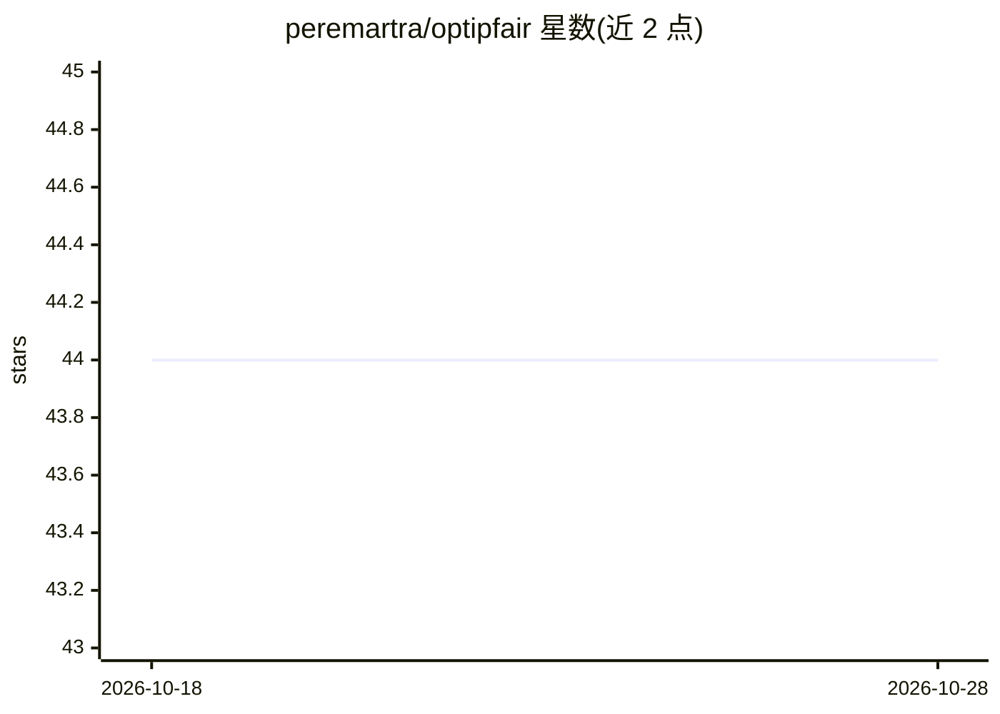

# peremartra/optipfair

⭐ 44 · Python · Apache-2.0 · 推送 2026-09-24 · [GitHub](https://github.com/peremartra/optipfair) · [官网](https://peremartra.github.io/optipfair/) · 个人维护

**LLM 结构化剪枝、知识蒸馏与偏见分析 Python 库**

面向 LLM 压缩的 Python 库，提供四个函数组成流水线：analyze（层重要性分析）→ prune（深度剪枝删除整层、宽度剪枝缩减神经元，默认 PPM 方法）→ distill（交叉熵+Skew KLD 组合损失恢复性能）→ deploy。另含偏见分析工具，通过 PCA、均值差、层热力图可视化模型内部激活对人口统计属性的处理方式。经 Qwen3.5-0.8B 与 Llama-3.2-3B 验证，是 Manning 书籍 Rearchitecting LLMs 的配套实现，附 Colab notebooks 与 HF Spaces 在线演示。

## 筛选速览

| 维度 | 判定 | 备注 |
|---|---|---|
| AI 角色 | `ai-ecosystem` | LLM/agent 周边工具 |
| 许可风险 | `permissive` | Apache-2.0 |
| 部署形态 | `library` | 以包/库形式分发 |
| 模型依赖 | — | README 未给出锁定关系 |
| 硬件要求 | — | 无带数字的原话,不猜 |
| 安装摩擦 | `low` | 无编译、无系统依赖或容器化 |
| 成熟度 | — | 结构信号不足 |

## 能力要点

- 深度剪枝（删整层）与宽度剪枝（PPM 方法）可顺序组合
- opf.distill_model() 组合损失蒸馏，无需自写训练循环
- 基于内部激活的偏见分析（PCA/均值差/层热力图）
- 提供 4 个 Colab notebook 与 HF Spaces 在线演示

## 适用场景

- 压缩 LLM 降低参数量与推理开销
- 剪枝后用知识蒸馏恢复模型性能
- 分析模型内部对人口统计属性的激活差异

## 场景标签

`模型量化` `模型评测` · 领域:评测与运维

## 证据(README 行号)

> L20: OptiPFair gives you a complete, composable workflow to compress a model and recover its performance.
> L29: You can apply **depth pruning** (remove entire layers), **width pruning** (reduce neuron count per layer), or **bot
> L113: `opf.distill_model()` trains the pruned model to recover performance using a combined loss (cross-entropy + Skew K

## 星数曲线

2026-10-18 44 → 2026-10-28 44（+0）

---
*卡片 v1 · prompt 1.4 · 生成 2026-10-25 · 置信度 high · 依据 README sha `537e43da0b5e` · [字段定义](../../DATASET.md)*
