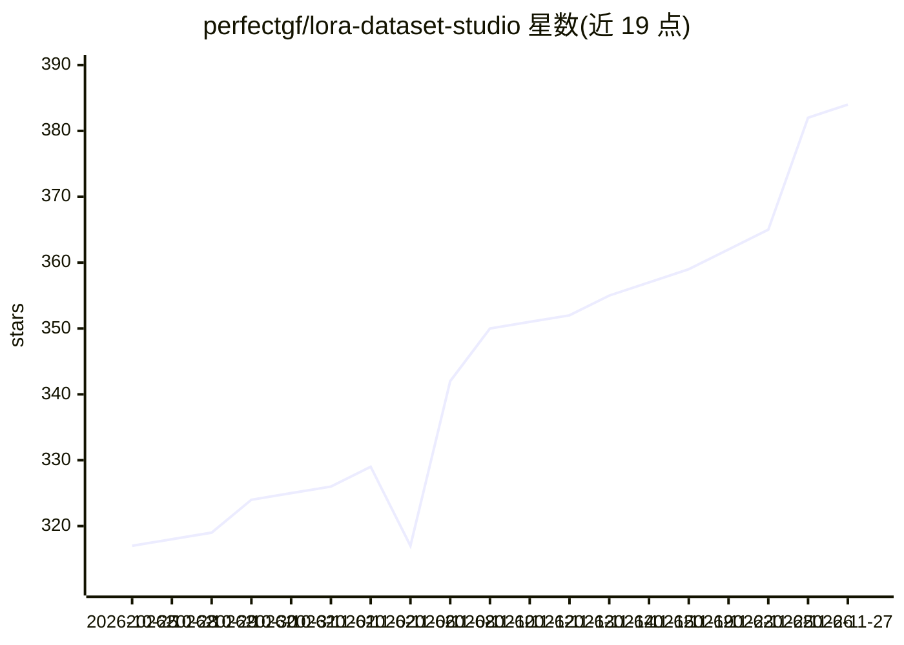

# perfectgf/lora-dataset-studio

⭐ 384 · Python · NOASSERTION · 推送 2026-11-26 · [GitHub](https://github.com/perfectgf/lora-dataset-studio) · [官网](https://perfectgf.github.io/lora-dataset-studio/) · 组织维护

**本地 LoRA 训练工作台：从单张照片到数据集、训练与选型**

在本地 PC 上运行的 LoRA 训练工作台：从一张参考照片生成缺失镜头或从大图库整理数据集，写 captions（prose 或 booru tags），通过 ai-toolkit 训练面向 Krea 2、FLUX.1、FLUX.2 Klein、Qwen-Image 2.1、Z-Image、SDXL、Anima 的 LoRA，并在同 seed 下渲染对比 checkpoint，支持投票与人脸相似度排名。核心功能无 GPU 可用；本地训练依赖 NVIDIA GPU（按任务 8–48 GB 不等），也可租用云 GPU。Windows 提供 ZIP 启动包，另支持 Docker、Pinokio 与源码安装。

## 筛选速览

| 维度 | 判定 | 备注 |
|---|---|---|
| AI 角色 | `ai-native` | 本体是模型或模型工具 |
| 许可风险 | `none` | NOASSERTION |
| 部署形态 | `desktop` | 安装包/桌面程序 |
| 模型依赖 | locked-api |  |
| 硬件要求 | `cpu-ok` | |
| 安装摩擦 | `medium` | 含编译或系统依赖之一 |
| 成熟度 | — | 结构信号不足 |

## 能力要点

- 从单张参考照片生成数据集所需镜头（5 种生成引擎）
- Image Bank：大图库评分、去重、聚类与短名单筛选
- 封装 ai-toolkit 的免配置训练与 checkpoint 同 seed 对比、投票排名
- 水印检测与修复、InsightFace 相似度检查等数据清洗工具

## 适用场景

- 为角色、风格或概念 LoRA 准备并清洗训练数据集
- 在本地 GPU 上训练 LoRA 并按证据挑选最佳 checkpoint
- 整理数千张图片的大文件夹并筛选可用训练素材

## 场景标签

`图像生成` `微调` · 领域:内容生成

## 证据(README 行号)

> L5: LDS builds the dataset for you: it generates the shots your photos are missing, sorts a big image folder, cleans wat
> L28: Complete **Setup**, then create a dataset or install the plugins you need. Importing, organizing and manually capti

## 星数曲线

2026-10-25 317 → 2026-11-27 384（+67）

---
*卡片 v1 · prompt 1.4 · 生成 2026-11-26 · 置信度 high · 依据 README sha `c1c20d2eee21` · [字段定义](../../DATASET.md)*
