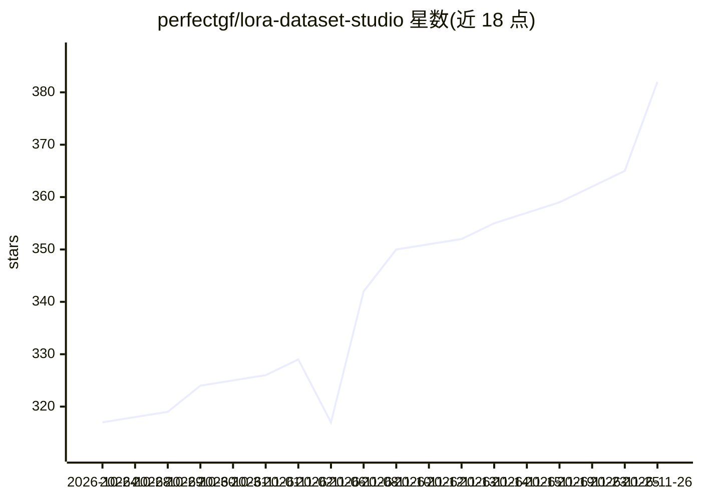

# perfectgf/lora-dataset-studio

⭐ 382 · Python · NOASSERTION · 推送 2026-11-25 · [GitHub](https://github.com/perfectgf/lora-dataset-studio) · [官网](https://perfectgf.github.io/lora-dataset-studio/) · 组织维护

**本地 LoRA 训练工作台：从单张照片建数据集到训练对比选优**

在本地浏览器中运行的 LoRA 数据集与训练工作台：从单张参考照生成缺失镜头、整理大图库、去水印并按目标模型风格写caption（JoyCaption、prose 或 booru tags），再调用 ai-toolkit 训练适配多个图像模型的 LoRA；同 seed 渲染各 checkpoint 并按投票与人脸相似度排名选优。核心功能无需 GPU；本地自动 caption、生成与训练分别有显存下限。提供 Windows ZIP、Git、Docker、Pinokio、RunPod 等安装路径，部分保留功能需付费会员。

## 筛选速览

| 维度 | 判定 | 备注 |
|---|---|---|
| AI 角色 | `ai-native` | 本体是模型或模型工具 |
| 许可风险 | `none` | NOASSERTION |
| 部署形态 | `desktop` | 安装包/桌面程序 |
| 模型依赖 | — | README 未给出锁定关系 |
| 硬件要求 | `cpu-ok` | |
| 安装摩擦 | `medium` | 含编译或系统依赖之一 |
| 成熟度 | — | 结构信号不足 |

## 能力要点

- 81 个工具覆盖单照扩图、图库分拣、caption、训练与 checkpoint 对比全流程
- 五个生成引擎：Nano Banana Pro、ChatGPT、OpenRouter 及经 ComfyUI 的本地 Klein/Krea 2 Edit
- Image Bank 单次评分提供美学/NSFW/风格排序、去重分组与可复用 embeddings
- Test Studio 固定 seed 网格对比、投票、Wilson 排名与人脸相似度排名

## 适用场景

- 从一张角色照快速构建并训练角色 LoRA
- 把几千张图的文件夹筛成平衡的数据集
- 同一数据集并行多个云端训练对比超参
- 固定 seed 逐个对比 checkpoint 选出最优

## 场景标签

`图像生成` `微调` · 领域:内容生成

## 证据(README 行号)

> L5: LDS builds the dataset for you: it generates the shots your photos are missing, sorts a big image folder, cleans wat
> L118: Pick a recipe and start: LDS fills in the ai-toolkit settings and scales the steps with the dataset, on your GPU o

## 星数曲线

2026-10-24 317 → 2026-11-26 382（+65）

---
*卡片 v1 · prompt 1.4 · 生成 2026-11-25 · 置信度 high · 依据 README sha `7e6f6f9b24d7` · [字段定义](../../DATASET.md)*
