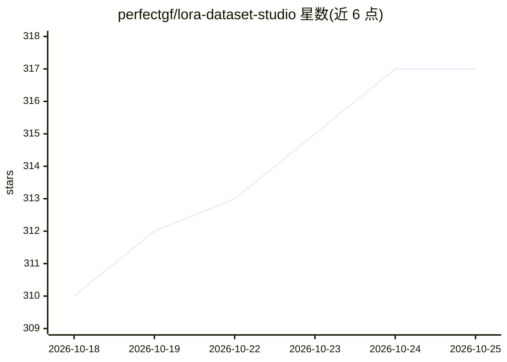

# perfectgf/lora-dataset-studio

⭐ 317 · Python · NOASSERTION · 推送 2026-10-24 · [GitHub](https://github.com/perfectgf/lora-dataset-studio) · 组织维护

**自托管浏览器工作台：构建/整理图像数据集并训练 LoRA**

本地运行的图像数据集与训练一体化工作台（Flask + React），功能覆盖 Character/Concept/Style 数据集构建、Image Bank 图库分拣（评分、去重、相似检索）、裁剪与水印清理、本地视觉模型或 JoyCaption 打标，随后通过 ai-toolkit 在七种图像模型家族（SDXL、FLUX.1/2、Krea 2 等）上训练 LoRA，并支持定点种子对比、排名测试生成结果。核心免费（PolyForm 非商业许可），新版本先发给 Patreon 会员；本地生成约需 16GB NVIDIA 显存，数据整理无需 GPU。

## 筛选速览

| 维度 | 判定 | 备注 |
|---|---|---|
| AI 角色 | `ai-ecosystem` | LLM/agent 周边工具 |
| 许可风险 | `none` | NOASSERTION |
| 部署形态 | `desktop` | 安装包/桌面程序 |
| 模型依赖 | — | README 未给出锁定关系 |
| 硬件要求 | — | 无带数字的原话,不猜 |
| 安装摩擦 | `medium` | 含编译或系统依赖之一 |
| 成熟度 | `idea` | |

## 能力要点

- 单浏览器界面覆盖数据集构建、整理、打标到 LoRA 训练全流程
- 基于 ai-toolkit 支持 Z-Image、SDXL、Krea 2、FLUX.1、FLUX.2 Klein、Anima、Qwen-Image 2.1 七个家族
- Image Bank 支持质量评分、重复/人物分组、文本与相似度检索
- 可选插件扩展 API 生成引擎、云端租 GPU 训练、Civitai/Hugging Face 发布等

## 适用场景

- 为角色/风格 LoRA 训练准备并整理图像数据集
- 在本地或租用 GPU 上训练 LoRA 并对比不同 checkpoint
- 批量打标、清理水印后打包标准训练 ZIP

## 场景标签

`微调` `图像视频处理` · 领域:感知与多模态

## 证据(README 行号)

> L8: Build, curate, caption and train image datasets from one browser interface. LDS runs on your machine and uses ai-too
> L34: |Local training|Guided ai-toolkit recipes for Z-Image, SDXL, Krea 2, FLUX.1, FLUX.2 Klein, Anima and Qwen-Image 2.1

## 星数曲线

2026-10-18 310 → 2026-10-25 317（+7）

---
*卡片 v1 · prompt 1.4 · 生成 2026-10-21 · 置信度 high · 依据 README sha `18312f51e7e6` · [字段定义](../../DATASET.md)*
