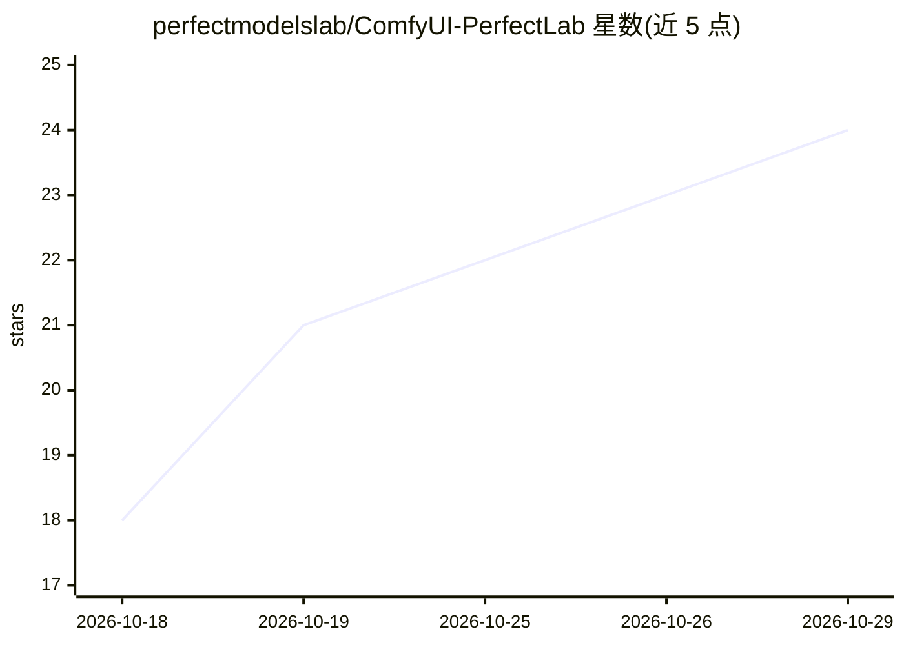

# perfectmodelslab/ComfyUI-PerfectLab

⭐ 24 · Python · MIT · 推送 2026-10-25 · [GitHub](https://github.com/perfectmodelslab/ComfyUI-PerfectLab) · [官网](https://registry.comfy.org/publishers/perfectmodelslab/nodes/comfyui-perfectlab) · 组织维护

**ComfyUI 单节点摄影棚提示词构建器：一键生成多镜头拍摄提示词**

PerfectLab Studio 是一个 ComfyUI 自定义节点：在单一节点面板内从带照片预览的库中挑选人物、服装、场景、光线与相机参数，按 START SHOOT 组装整组提示词、尺寸与种子并发送进用户的 ComfyUI 图。含 625 个库值、553 张照片瓦片、多镜头会话、剧情弧线、wildcards 与提示词 linter，并针对 Z-Image、Flux、Qwen-Image、SDXL 提供模型感知的 token 预算。无 Python 依赖，解压重启即用，MIT 许可。

## 筛选速览

| 维度 | 判定 | 备注 |
|---|---|---|
| AI 角色 | `ai-ecosystem` | LLM/agent 周边工具 |
| 许可风险 | `permissive` | MIT |
| 部署形态 | `None` |  |
| 模型依赖 | — | README 未给出锁定关系 |
| 硬件要求 | — | 无带数字的原话,不猜 |
| 安装摩擦 | `low` | 无编译、无系统依赖或容器化 |
| 成熟度 | — | 结构信号不足 |

## 能力要点

- 625 个带照片预览的库值（服装/场景/光线/镜头/姿势/表情）
- 多镜头会话与剧情弧线，每帧独立种子与元数据
- 内置 linter 检查 token 预算、重复、括号失衡与缺失 wildcard
- 按模型设定 token 预算（Z-Image/Flux/Qwen-Image/SDXL）

## 适用场景

- 在 ComfyUI 里策划并批量生成一组风格连贯的 AI 人像照片
- 用固定种子做干净 A/B 对比或保持人物描述稳定
- 借助角色 LoRA 触发词在多张照片间保持同一张脸

## 场景标签

`提示工程` `图像生成` · 领域:Agent 开发

## 证据(README 行号)

> L8: PerfectLab Studio builds AI photoshoots inside one ComfyUI node. Pick the person, the outfit, the place, the light a
> L26: 2. Open the bundled workflow: workflows/perfectlab_base_workflow.json, wired end to end with a demo shoot already p

## 星数曲线

2026-10-18 18 → 2026-10-29 24（+6）

---
*卡片 v1 · prompt 1.4 · 生成 2026-10-27 · 置信度 high · 依据 README sha `50e502c94c86` · [字段定义](../../DATASET.md)*
