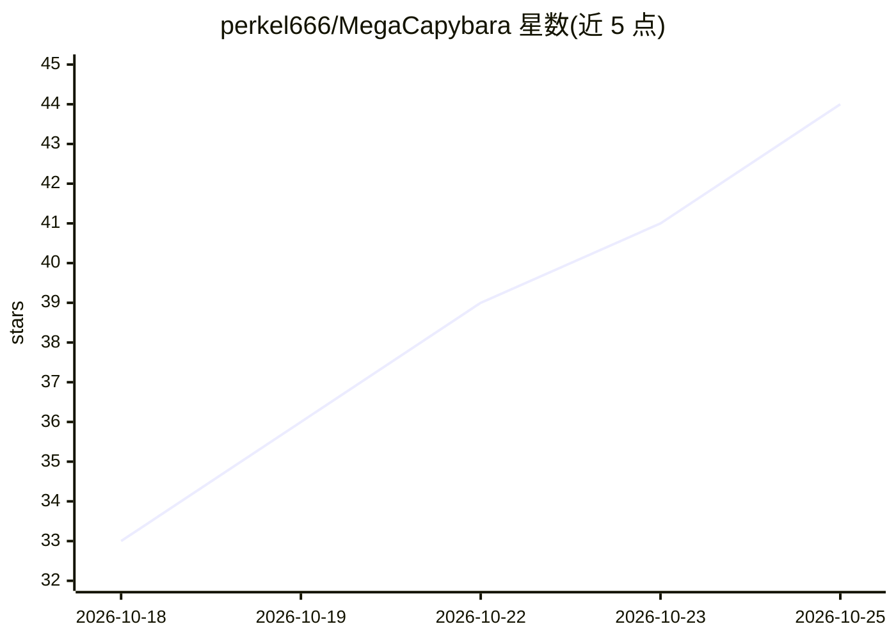

# perkel666/MegaCapybara

⭐ 44 · MIT · 推送 2026-10-21 · [GitHub](https://github.com/perkel666/MegaCapybara) · [官网](https://huggingface.co/perkel/Qwen3.8-27B-MC) · 个人维护

**面向 RTX 5090 的 Qwen3.8 推理引擎，多 agent 共享上下文高并发服务**

针对 NVIDIA RTX 5090 的本地推理引擎，运行 Qwen3.8-27B 与 Flash-Next 的 MXFP4/MXFP6 量化模型，提供推测解码、连续批处理（最多 12 个 agent）、共享上下文池、分页显存与多级缓存调度。附带启动器，在加载前展示每个设置对精度、速度和内存的影响，可一键从 Hugging Face 下载模型。同时兼容 OpenAI 与 Anthropic API（含工具调用、thinking、图像），供 Claude Code、OpenCode、Cline 等客户端接入。限制：需 RTX 5090 与 R580 以上驱动，源码尚未发布（仅发布程序）。

## 筛选速览

| 维度 | 判定 | 备注 |
|---|---|---|
| AI 角色 | `ai-ecosystem` | LLM/agent 周边工具 |
| 许可风险 | `permissive` | MIT |
| 部署形态 | `None` |  |
| 模型依赖 | locked-api |  |
| 硬件要求 | — | 无带数字的原话,不猜 |
| 安装摩擦 | `low` | 无编译、无系统依赖或容器化 |
| 成熟度 | — | 结构信号不足 |

## 能力要点

- MXFP4/MXFP6 量化内核 + 推测解码（DFlash2/MTP），单 agent 500+ tok/s、12 agent 最高 2,800 tok/s
- 共享上下文池、连续批处理、分页显存与 VRAM/RAM/磁盘三级缓存调度
- 启动器展示每个设置的精度/速度/内存开销，模型文件自带 Top-1 agreement 精度数据
- 同时提供 OpenAI 与 Anthropic 兼容 API，支持工具调用、thinking 与图像

## 适用场景

- 在单张 RTX 5090 上同时驱动多个编码 agent（如 Claude Code、OpenCode、Cline）
- 长上下文（最高 1M tokens）本地推理，按需查看精度-速度权衡
- 团队内部网络部署带密码保护的本地 LLM 服务

## 场景标签

`推理引擎` · 领域:训练与推理

## 证据(README 行号)

> L124: MegaCapybara speaks both OpenAI's and Anthropic's APIs, including tool calls, thinking and images. Point your clie
> L3:  The fastest inference engine for Qwen3.8-27B and Qwen3.8 Flash-Next on the NVIDIA GeForce RTX 5090.

## 星数曲线

2026-10-18 33 → 2026-10-25 44（+11）

---
*卡片 v1 · prompt 1.4 · 生成 2026-10-25 · 置信度 high · 依据 README sha `08a1a2b2ecee` · [字段定义](../../DATASET.md)*
