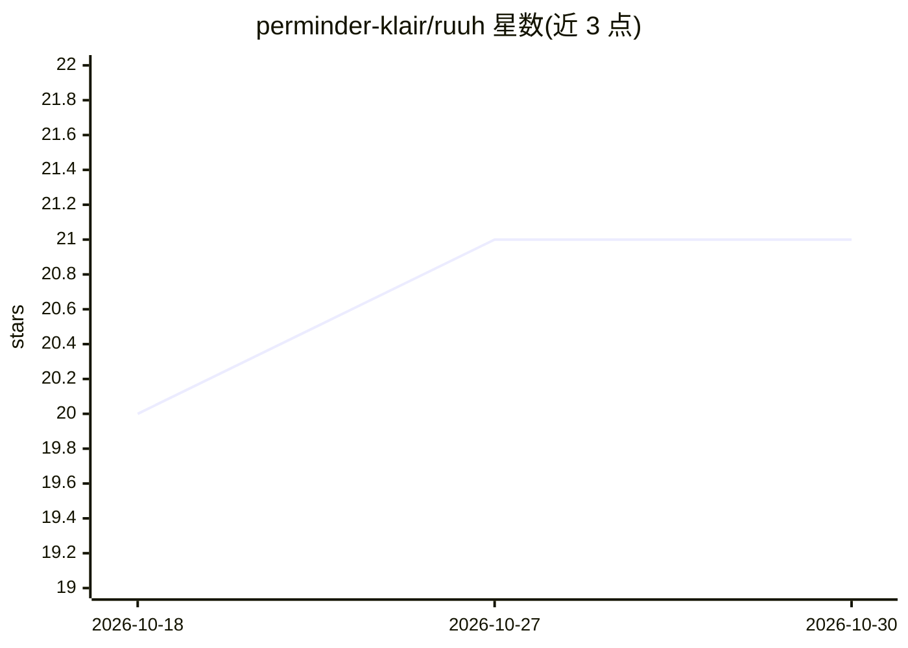

# perminder-klair/ruuh

⭐ 21 · TypeScript · MIT · 推送 2026-02-23 · [GitHub](https://github.com/perminder-klair/ruuh) · [官网](https://ruuh.klair.co) · 个人维护

**在 Android Termux 上一键部署的个人 AI 助手环境**

面向 Android 用户的一键安装脚本集合：通过 Termux 安装 proot Ubuntu 与 Node.js 22，部署 pi-coding-agent 作为手机上的个人 AI 编码助手，并生成 persona、记忆、工具等配置文件到共享存储，可用任意文本编辑器修改。可选安装 Ollama 运行本地模型（如 qwen3:1.7b）或使用云端模型，可选安装 Termux API 技能使 agent 能调用摄像头、短信、传感器等设备功能，另有 Web 监控面板。附带 Docker 测试环境模拟 Termux 供无设备调试。

## 筛选速览

| 维度 | 判定 | 备注 |
|---|---|---|
| AI 角色 | `ai-native` | 本体是模型或模型工具 |
| 许可风险 | `permissive` | MIT |
| 部署形态 | `None` |  |
| 模型依赖 | local-ok | 支持本地模型 |
| 硬件要求 | — | 无带数字的原话,不猜 |
| 安装摩擦 | `low` | 无编译、无系统依赖或容器化 |
| 成熟度 | — | 结构信号不足 |

## 能力要点

- 一条 curl 命令完成 Termux 内 Ubuntu+Node.js+pi-coding-agent 部署
- 可选 Ollama 本地模型（qwen3:1.7b）或云端模型
- Termux API 技能赋予 agent 摄像头/短信/传感器等设备控制能力
- 配置文件存放于 /sdcard/ruuh/ 共享存储，任意 Android 应用可编辑

## 适用场景

- 把旧 Android 手机变成随身 AI 编码助手
- 通过对话让 agent 操作手机硬件与通信功能
- 本地运行小模型避免依赖云端 API

## 场景标签

`编码 Agent` `AI 助手` · 领域:编码与开发

## 证据(README 行号)

> L3: A one-command setup script that turns Termux into a fully configured AI coding environment on Android. It installs U
> L34: ruuh --ollama

## 星数曲线

2026-10-18 20 → 2026-10-30 21（+1）

---
*卡片 v1 · prompt 1.4 · 生成 2026-10-28 · 置信度 high · 依据 README sha `fe347bbffd98` · [字段定义](../../DATASET.md)*
