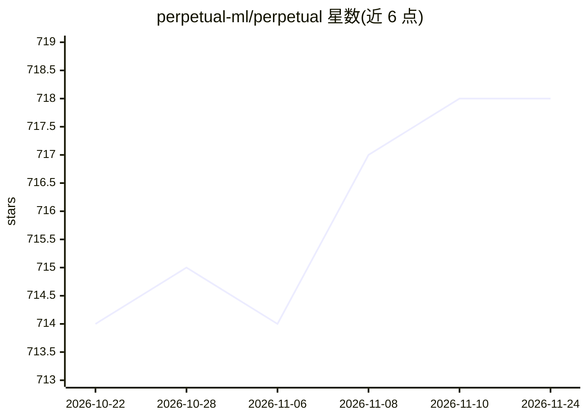

# perpetual-ml/perpetual

⭐ 718 · Rust · Apache-2.0 · 推送 2026-11-11 · [GitHub](https://github.com/perpetual-ml/perpetual) · [官网](https://perpetual-ml.github.io/perpetual) · 组织维护

**免调参的梯度提升库：用 budget 参数单次训练得出模型**

PerpetualBooster 是一个无需超参数优化的梯度提升机（GBM），通过 budget 参数控制预测能力，用户从小预算起步逐步增大即可。Rust 实现，提供 Python、Rust、R 三语言接口；支持二分类/多分类、回归与排序，原生处理类别变量与缺失值，内置因果 ML、漂移监测、持续学习、概率校准与 SHAP 可解释性，模型可导出为 XGBoost 或 ONNX 格式。pandas/polars/scikit-learn 等为可选依赖。

## 筛选速览

| 维度 | 判定 | 备注 |
|---|---|---|
| AI 角色 | `ai-native` | 本体是模型或模型工具 |
| 许可风险 | `permissive` | Apache-2.0 |
| 部署形态 | `library` | 以包/库形式分发 |
| 模型依赖 | — | README 未给出锁定关系 |
| 硬件要求 | — | 无带数字的原话,不猜 |
| 安装摩擦 | `low` | 无编译、无系统依赖或容器化 |
| 成熟度 | — | 结构信号不足 |

## 能力要点

- budget 参数替代超参数优化，单次运行训练
- Rust 核心，支持 Polars/Arrow 零拷贝数据
- 支持分类、回归、排序，内置因果 ML 与漂移监测
- 模型可导出为 XGBoost / ONNX 格式

## 适用场景

- 表格数据的分类与回归建模
- 不想花时间做超参数调优的建模任务
- 需要漂移监测和持续学习的生产场景
- 以 SHAP/部分依赖图解释模型决策

## 场景标签

`数据分析` · 领域:效率与自动化

## 证据(README 行号)

> L19: PerpetualBooster is a gradient boosting machine (GBM) that doesn't need hyperparameter optimization unlike other GB
> L23: - **Hyperparameter-Free Learning:** Achieves optimal accuracy in a single run via a simple `budget` parameter, elim

## 星数曲线

2026-10-22 714 → 2026-11-24 718（+4）

---
*卡片 v1 · prompt 1.4 · 生成 2026-11-24 · 置信度 high · 依据 README sha `aa6edaceeab7` · [字段定义](../../DATASET.md)*
